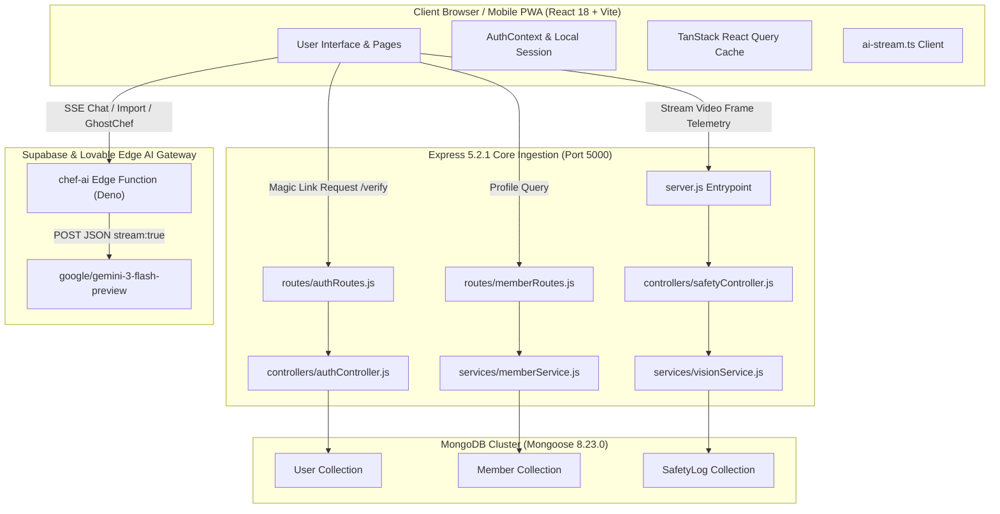
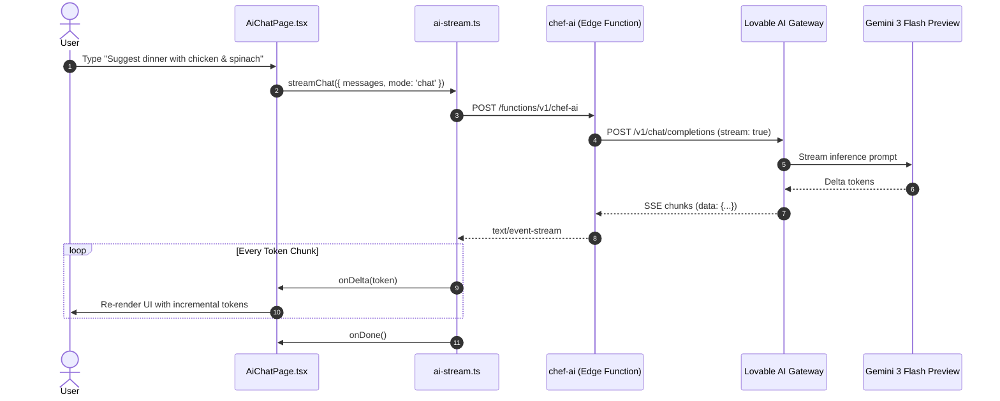
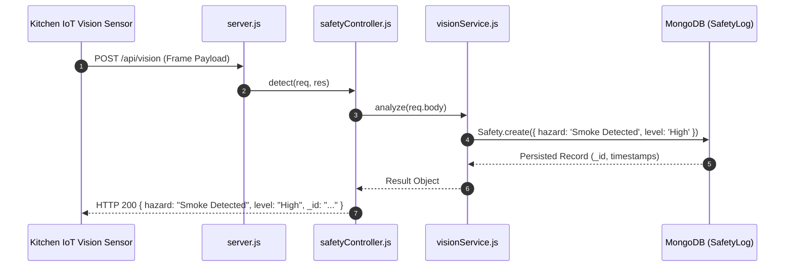
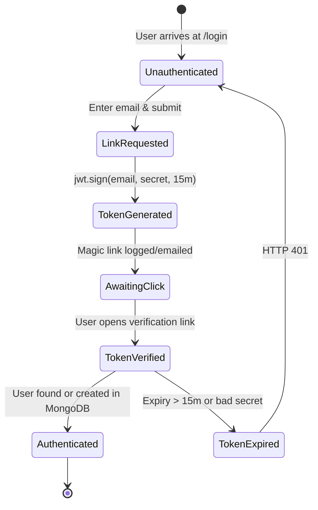

# Step 0: Full Project Analysis

This document provides an exhaustive, code-grounded analysis of the **Cooking Nexus & Culinary Companion Pro** ecosystem, analyzing both the core backend ingestion service and the full interactive React 18 single-page application.

---

## 0.1 What the Project Is

### Name & Mission
- **Project Name**: Cooking Nexus (Culinary Companion Pro)
- **Primary Mission**: An intelligent culinary operating system that bridges hands-free cooking guidance, social video reels, pre-trained generative culinary AI, smart appliance IoT telemetry, and real-time kitchen safety computer vision.

### Problems Solved
1. **Kitchen Multi-Tasking Friction**: Home cooks frequently have messy hands (flour, oil, water), making touching phone or tablet screens during recipe execution impractical and unhygienic.
2. **Unattended Kitchen Hazards**: Cooking fires and smoke incidents often occur when chefs leave stoves unattended. Cooking Nexus integrates continuous computer vision hazard detection.
3. **Recipe Execution Disconnect**: Traditional recipe websites provide static text without real-time step guidance, synchronized multi-timers, ingredient scaling, or interactive substitution advice.
4. **Creator Economy Fragmented Tools**: Food video creators struggle to link video timestamps directly to structured ingredient lists, nutrition cards, and affiliate grocery links.

### Target Personas
- **The Home Cook**: Seeks guided meal preparation, intelligent substitutions, and synchronized timers without touching screens.
- **The Food Creator / Culinary Uploader**: Uploads 60-second vertical cooking reels, tags recipes with interactive overlays, and monetizes through viewer tips and affiliate ingredients.
- **The Smart Home Enthusiast**: Connects smart ovens, fridge cameras, and Bluetooth kitchen scales into a centralized telemetry hub.

### Complete Screen & Route Inventory

| Route Path | View Component | Access Level | Key User Capabilities |
|---|---|---|---|
| `/` | `Index.tsx` | Public | Hero introduction, trending recipe carousels, feature highlights, CTA to register or log in |
| `/login` | `Login.tsx` | Public | Passwordless magic link request, local authentication credentials input, dark mode toggle |
| `/reels` | `ReelsFeed.tsx` | Protected | Fullscreen vertical culinary reel player with swipe navigation, likes, comments, and recipe drawer |
| `/recipe/:id` | `RecipeDetail.tsx` | Protected | Deep-dive recipe breakdown: portion scaler, ingredient checklist, nutritional facts, timer triggers |
| `/watch/:id` | `WatchVideo.tsx` | Protected | High-definition horizontal video player with timestamped recipe chapter overlays and live chat |
| `/ai-kitchen` | `AIKitchen.tsx` | Protected | Multi-mode generative chef assistant: conversational recipe ideation, ingredient substitution matrix |
| `/ghost-chef` | `GhostChefComparison.tsx` | Protected | Side-by-side culinary comparison between classic techniques vs modern gastronomy using Gemini 3 |
| `/profile/:userId` | `UserProfilePage.tsx` | Protected | Public user profile, follower/following stats, published recipe portfolio, creator bio |
| `/dashboard` | `UserDashboard.tsx` | Protected | Cook analytics, favorited recipe library, weekly meal plans, and recent kitchen logs |
| `/uploader` | `UploaderDashboard.tsx` | Protected | Creator studio: reel upload wizard, automatic thumbnail generator, earnings breakdown |
| `/app` | `AppDashboard.tsx` | Protected (Sidebar) | Central control center: kitchen status, quick timer launcher, active grocery list preview |
| `/app/recipes` | `RecipesPage.tsx` | Protected (Sidebar) | Searchable and filterable master culinary directory by cuisine, difficulty, prep time, tags |
| `/app/kitchen` | `KitchenPage.tsx` | Protected (Sidebar) | IoT appliance monitor: oven pre-heat controls, fridge camera inventory feed, weight scale sync |
| `/app/meal-planner`| `MealPlannerPage.tsx` | Protected (Sidebar) | Drag-and-drop weekly calendar: breakfast, lunch, dinner allocation, automatic grocery sync |
| `/app/checklists` | `ChecklistsPage.tsx` | Protected (Sidebar) | Mise-en-place equipment verification, pre-cooking safety and sanitary checklists |
| `/app/timer` | `TimerPage.tsx` | Protected (Sidebar) | Multi-stage parallel kitchen timers with audio chime alerts and customizable phase labels |
| `/app/converter` | `ConverterPage.tsx` | Protected (Sidebar) | Precision culinary unit converter: grams to ounces, cups to milliliters, Celsius to Fahrenheit |
| `/app/social` | `SocialPage.tsx` | Protected (Sidebar) | Community activity feed: dish plating photos, user comments, social poll updates |
| `/app/ai-chat` | `AiChatPage.tsx` | Protected (Sidebar) | Real-time conversational culinary streaming interface with markdown formatting |
| `/app/privacy` | `PrivacyPage.tsx` | Protected (Sidebar) | Zero-trust privacy controls, local session purge, GDPR data export, camera stream toggles |
| `/app/settings` | `SettingsPage.tsx` | Protected (Sidebar) | UI theme preferences (dark/light), notification switches, IoT device pairing manager |
| `/app/nutrition`| `NutritionTrackerPage.tsx`| Protected (Sidebar) | Daily macronutrient breakdown (protein, carbs, fat, calories) aggregated from cooked recipes |
| `/app/shopping` | `ShoppingListPage.tsx` | Protected (Sidebar) | Consolidated grocery list organized by supermarket aisle with strike-through completion |
| `/app/favorites` | `FavoritesPage.tsx` | Protected (Sidebar) | Bookmarked recipe collections with custom user tagging and offline caching |
| `/app/share` | `RecipeSharePage.tsx` | Protected (Sidebar) | Export recipe cards as shareable social cards, QR codes, or printable PDF sheets |
| `/app/journal` | `CookingJournalPage.tsx` | Protected (Sidebar) | Personal cooking diary: photo logs, taste rating, seasoning tweaks, cooking notes |
| `/app/live` | `LiveStreamPage.tsx` | Protected (Sidebar) | Interactive creator live stream with real-time viewer questions and ingredient tips |
| `/app/search` | `GlobalSearchPage.tsx` | Protected (Sidebar) | Unified omni-search indexing recipes, chefs, ingredients, videos, and articles |
| `/app/import` | `RecipeImportPage.tsx` | Protected (Sidebar) | AI-powered web recipe importer: pastes raw URL or unstructured text into structured recipe JSON |
| `/app/notifications`|`NotificationsPage.tsx`| Protected (Sidebar) | System and social alerts: timer expirations, new followers, reel comments, safety warnings |
| `/app/collections`| `RecipeCollectionsPage.tsx`| Protected (Sidebar) | Custom curated recipe binders (e.g., "30-Minute Dinners", "Holiday Baking") |

---

## 0.2 System Architecture & Master Feature Trace

### Trace F1: AI Generative Chef & Structured Recipe Extraction
- **User Action**: The user opens `/app/ai-chat` or `/app/import` and types an ingredient list or pastes a raw URL.
- **Frontend Flow**: [27-kitchen-companion-pro/src/pages/AiChatPage.tsx](file:///Users/avishjain/avishjain9-repos/26-cooking-nexus/27-kitchen-companion-pro/src/pages/AiChatPage.tsx) calls `streamChat()` in [src/lib/ai-stream.ts](file:///Users/avishjain/avishjain9-repos/26-cooking-nexus/27-kitchen-companion-pro/src/lib/ai-stream.ts#L5-L98).
- **Edge API Call**: POST to `${VITE_SUPABASE_URL}/functions/v1/chef-ai` with `{ messages, mode: "chat" | "import" | "ghostchef" }`.
- **Backend Flow**: [supabase/functions/chef-ai/index.ts](file:///Users/avishjain/avishjain9-repos/26-cooking-nexus/27-kitchen-companion-pro/supabase/functions/chef-ai/index.ts#L33-L90) validates `LOVABLE_API_KEY`, selects the system prompt, forwards to `https://ai.gateway.lovable.dev/v1/chat/completions` requesting `google/gemini-3-flash-preview` with `stream: true`.
- **Response Path**: Streams Server-Sent Events (`text/event-stream`), parsed line-by-line in `ai-stream.ts` via `TextDecoder` and `reader.read()`, dispatching token deltas into React state.
- **Failure Paths**: HTTP 429 returns "Rate limit reached", HTTP 402 returns "AI credits exhausted", network disconnect triggers `onError`.

### Trace F2: Real-Time Kitchen Safety Computer Vision Guard
- **User Action**: The IoT kitchen camera periodically sends an optical frame payload to verify stove safety.
- **Frontend / Device Flow**: Smart camera daemon issues HTTP POST to `/api/vision`.
- **Backend Flow**: [server.js:L5](file:///Users/avishjain/avishjain9-repos/26-cooking-nexus/server.js#L5) dispatches to [controllers/safetyController.js:L2](file:///Users/avishjain/avishjain9-repos/26-cooking-nexus/controllers/safetyController.js#L2) -> [services/visionService.js:L2](file:///Users/avishjain/avishjain9-repos/26-cooking-nexus/services/visionService.js#L2).
- **Database Write**: `SafetyLog.create({ hazard: 'Smoke Detected', level: 'High' })` in [models/SafetyLog.js:L6](file:///Users/avishjain/avishjain9-repos/26-cooking-nexus/models/SafetyLog.js#L6).
- **Response Path**: HTTP 200 JSON with created safety log record.
- **Failure Path**: HTTP 500 with `{ error: err.message }` caught by safety controller try/catch block.

### Trace F3: Passwordless Magic Link & JWT Authentication
- **User Action**: User enters email on `/login` and clicks "Send Magic Link".
- **Backend Flow**: POST `/api/auth/login` handled by [controllers/authController.js:L6](file:///Users/avishjain/avishjain9-repos/26-cooking-nexus/controllers/authController.js#L6) -> generates signed JWT with 15-minute expiry (`jwt.sign({ email }, process.env.JWT_SECRET)`).
- **Verification**: When user clicks the link (`/api/auth/verify?token=...`), [controllers/authController.js:L18](file:///Users/avishjain/avishjain9-repos/26-cooking-nexus/controllers/authController.js#L18) verifies signature, performs upsert (`User.findOne({ email }) || User.create({ email })`), and returns HTTP 200 with user session.
- **Failure Path**: Invalid/expired token returns HTTP 401 `{ message: "Invalid or expired token" }`.

---

## 0.3 Inventory of All APIs, Keys & Secrets

### Backend Endpoints Table
| Method | Path | Auth Required | Controller & Function | Data Operation | Purpose |
|---|---|---|---|---|---|
| `POST` | `/api/vision` | None (Edge Interlock) | [controllers/safetyController.js:L2](file:///Users/avishjain/avishjain9-repos/26-cooking-nexus/controllers/safetyController.js#L2) `detect` | Insert `SafetyLog` | Kitchen safety hazard vision ingestion |
| `POST` | `/api/auth/login` | None | [controllers/authController.js:L6](file:///Users/avishjain/avishjain9-repos/26-cooking-nexus/controllers/authController.js#L6) `requestLink` | None | Signs and issues 15-minute magic login token |
| `GET` | `/api/auth/verify` | Token Query Param | [controllers/authController.js:L18](file:///Users/avishjain/avishjain9-repos/26-cooking-nexus/controllers/authController.js#L18) `verifyLink` | Query / Insert `User` | Verifies JWT and returns user session |
| `GET` | `/api/members/:id`| None (Future Auth) | [controllers/memberController.js:L2](file:///Users/avishjain/avishjain9-repos/26-cooking-nexus/controllers/memberController.js#L2) `getProfile` | Query `Member` | Retrieves user profile excluding password hash |

### External APIs & Edge Endpoints
| Provider | Purpose | Target URL | Header / Auth | Line Reference |
|---|---|---|---|---|
| **Lovable AI Gateway** | Pre-trained Gemini 3 Flash LLM | `https://ai.gateway.lovable.dev/v1/chat/completions` | `Bearer ${LOVABLE_API_KEY}` | [supabase/functions/chef-ai/index.ts:L43](file:///Users/avishjain/avishjain9-repos/26-cooking-nexus/27-kitchen-companion-pro/supabase/functions/chef-ai/index.ts#L43) |
| **Supabase Edge Function** | Edge chat & recipe extraction proxy | `${VITE_SUPABASE_URL}/functions/v1/chef-ai` | `Bearer ${VITE_SUPABASE_PUBLISHABLE_KEY}` | [src/lib/ai-stream.ts:L19](file:///Users/avishjain/avishjain9-repos/26-cooking-nexus/27-kitchen-companion-pro/src/lib/ai-stream.ts#L19) |

### Environment Variables & Secrets
| Variable Name | Required By | Functional Purpose | Where Defined / Read | Where to Obtain |
|---|---|---|---|---|
| `PORT` | Node.js Server | Ingestion server listening port (5000) | [.env:L1](file:///Users/avishjain/avishjain9-repos/26-cooking-nexus/.env#L1), `server.js` | Local configuration |
| `MONGO_URI` | Mongoose Driver | MongoDB connection string | [.env:L2](file:///Users/avishjain/avishjain9-repos/26-cooking-nexus/.env#L2) | Local MongoDB / MongoDB Atlas |
| `JWT_SECRET` | Auth Controller | HMAC signature secret for Magic Link JWTs | [.env:L3](file:///Users/avishjain/avishjain9-repos/26-cooking-nexus/.env#L3), [authController.js:L8](file:///Users/avishjain/avishjain9-repos/26-cooking-nexus/controllers/authController.js#L8) | Cryptographically generated secret |
| `LOVABLE_API_KEY`| Supabase Deno Function | Authentication with Lovable AI Gateway | [chef-ai/index.ts:L38](file:///Users/avishjain/avishjain9-repos/26-cooking-nexus/27-kitchen-companion-pro/supabase/functions/chef-ai/index.ts#L38) | Lovable Developer Platform |
| `VITE_SUPABASE_URL`| Vite Frontend App | URL of Supabase backend & edge functions | `src/lib/ai-stream.ts:L3`, `supabase/client.ts` | Supabase project dashboard |
| `VITE_SUPABASE_PUBLISHABLE_KEY`| Vite Frontend App | Anon public key for Supabase client calls | `src/lib/ai-stream.ts:L23`, `supabase/client.ts` | Supabase project dashboard |

---

## 0.4 React Hooks, Shared Helpers & Middleware

### React Hooks
- `useAuth`: Custom hook defined in [AuthContext.tsx:L33](file:///Users/avishjain/avishjain9-repos/26-cooking-nexus/27-kitchen-companion-pro/src/contexts/AuthContext.tsx#L33) exposing `user`, `profile`, `signIn`, `signUp`, `signOut`, `isDark`, `toggleDark`.
- `useToast`: Custom notification hook defined in [src/components/ui/use-toast.ts](file:///Users/avishjain/avishjain9-repos/26-cooking-nexus/27-kitchen-companion-pro/src/components/ui/use-toast.ts).
- `useMobile`: Viewport breakpoint detection hook in [src/hooks/use-mobile.tsx](file:///Users/avishjain/avishjain9-repos/26-cooking-nexus/27-kitchen-companion-pro/src/hooks/use-mobile.tsx).

### Shared Helpers & Libraries
- `streamChat()`: Asynchronous SSE reader and parser in [src/lib/ai-stream.ts](file:///Users/avishjain/avishjain9-repos/26-cooking-nexus/27-kitchen-companion-pro/src/lib/ai-stream.ts).
- `cn()`: Class merge utility combining `clsx` and `tailwind-merge` in [src/lib/utils.ts](file:///Users/avishjain/avishjain9-repos/26-cooking-nexus/27-kitchen-companion-pro/src/lib/utils.ts).

### Backend Middleware Chain
- `express.json()`: Global body parser in [server.js:L3](file:///Users/avishjain/avishjain9-repos/26-cooking-nexus/server.js#L3).
- `authMiddleware.js`: [middleware/authMiddleware.js](file:///Users/avishjain/avishjain9-repos/26-cooking-nexus/middleware/authMiddleware.js) (Scaffolded for Bearer token validation).
- `errorMiddleware.js`: [middleware/errorMiddleware.js](file:///Users/avishjain/avishjain9-repos/26-cooking-nexus/middleware/errorMiddleware.js) (Centralized error handler scaffold).

---

## 0.5 Final Inventory Counts

| Metric Category | Count | Verification Evidence |
|---|---|---|
| **Frontend Page Routes** | **31** | Explicit `<Route>` declarations in [App.tsx:L61-L97](file:///Users/avishjain/avishjain9-repos/26-cooking-nexus/27-kitchen-companion-pro/src/App.tsx#L61-L97) |
| **UI Components (Shadcn + Core)** | **53** | 43 Radix primitives in `src/components/ui/` + 10 domain components in `src/components/` |
| **Custom React Hooks** | **3** | `useAuth`, `useToast`, `useMobile` |
| **Total Features Identified** | **10** | F1 (AI Gen/Import), F2 (Safety Vision), F3 (Magic Auth), F4 (Reels Player), F5 (Portion Scaler), F6 (Multi-Timer), F7 (Meal Planner), F8 (Ghost Chef), F9 (IoT Appliance Hub), F10 (Grocery Sync) |
| **Backend REST Endpoints** | **4** | `/api/vision`, `/api/auth/login`, `/api/auth/verify`, `/api/members/:id` |
| **Mongoose Database Models** | **3** | `User` ([models/User.js](file:///Users/avishjain/avishjain9-repos/26-cooking-nexus/models/User.js)), `Member` ([models/Member.js](file:///Users/avishjain/avishjain9-repos/26-cooking-nexus/models/Member.js)), `Safety` ([models/SafetyLog.js](file:///Users/avishjain/avishjain9-repos/26-cooking-nexus/models/SafetyLog.js)) |
| **External AI / Edge Gateways** | **2** | Lovable AI Gateway (`google/gemini-3-flash-preview`), Supabase Edge (`chef-ai`) |
| **Environment Variables** | **6** | `PORT`, `MONGO_URI`, `JWT_SECRET`, `LOVABLE_API_KEY`, `VITE_SUPABASE_URL`, `VITE_SUPABASE_PUBLISHABLE_KEY` |
| **Dependencies & DevDependencies** | **64** | 3 root dependencies + 3 root devDeps + 44 frontend dependencies + 14 frontend devDeps |
