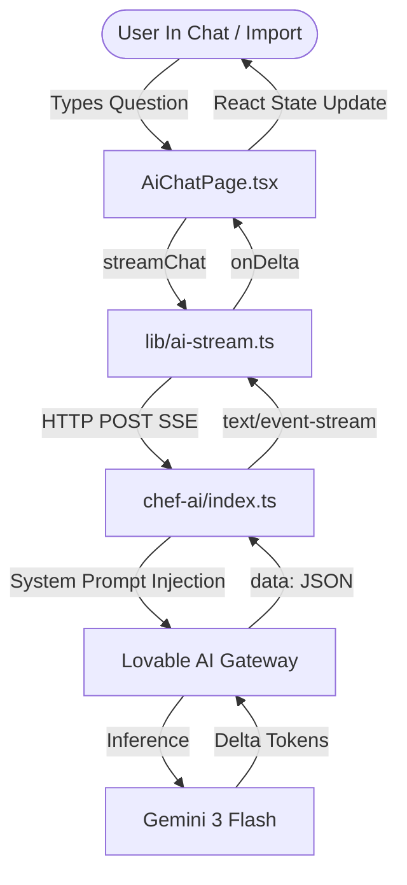
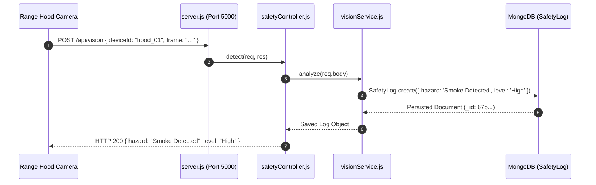
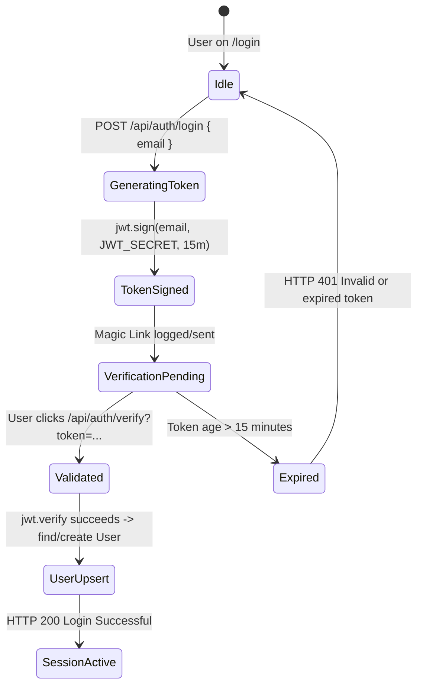
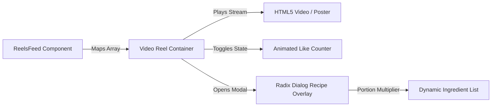

# Step 2: Master Feature Inventory

This document details all 10 core and subsystem features of the Cooking Nexus platform. Every feature includes exact file paths, line numbers, data interactions, edge cases, diagrams, and a conversational **Say It Out Loud** rehearsal script.

---

## Feature F1: AI Generative Chef & Structured Recipe Extraction

### Overview & User Experience
- **Description**: Conversational generative cooking assistant and web recipe extraction engine powered by Google's Gemini 3 Flash.
- **User Behavior**: Home cooks type queries ("What can I make with tomatoes and basil?") or paste raw recipe web text. The system responds with instant, streaming markdown or parses raw text into structured recipe JSON with cook times and ingredient arrays.

### Files & Function Call Graph
- **Client Consumer**: [src/lib/ai-stream.ts:L5-L98](file:///Users/avishjain/avishjain9-repos/26-cooking-nexus/27-kitchen-companion-pro/src/lib/ai-stream.ts#L5-L98) (`streamChat({ messages, mode, onDelta, onDone, onError })`)
- **UI Trigger**: [src/pages/AiChatPage.tsx](file:///Users/avishjain/avishjain9-repos/26-cooking-nexus/27-kitchen-companion-pro/src/pages/AiChatPage.tsx) and [src/pages/RecipeImportPage.tsx](file:///Users/avishjain/avishjain9-repos/26-cooking-nexus/27-kitchen-companion-pro/src/pages/RecipeImportPage.tsx)
- **Edge Function**: [supabase/functions/chef-ai/index.ts:L33-L90](file:///Users/avishjain/avishjain9-repos/26-cooking-nexus/27-kitchen-companion-pro/supabase/functions/chef-ai/index.ts#L33-L90) (`serve(async (req) => ...)`)

### Data Touched & APIs Exposed
- **APIs**: POST `${VITE_SUPABASE_URL}/functions/v1/chef-ai` -> POST `https://ai.gateway.lovable.dev/v1/chat/completions`
- **Payload**: `{ messages: [{ role: "user", content: string }], mode: "chat" | "ghostchef" | "import" }`
- **Output**: `text/event-stream` returning SSE chunks with `parsed.choices[0].delta.content`.

### Edge Cases & Handling
- **HTTP 429 Rate Limit**: Triggers `onError("Rate limit reached. Please wait a moment and try again.")` in [ai-stream.ts:L30](file:///Users/avishjain/avishjain9-repos/26-cooking-nexus/27-kitchen-companion-pro/src/lib/ai-stream.ts#L30).
- **HTTP 402 Credits Exhausted**: Triggers `onError("AI credits exhausted. Please add funds.")` in [ai-stream.ts:L34](file:///Users/avishjain/avishjain9-repos/26-cooking-nexus/27-kitchen-companion-pro/src/lib/ai-stream.ts#L34).
- **Stream Incompletion**: Flushes lingering `textBuffer` after while-loop termination in [ai-stream.ts:L78-L92](file:///Users/avishjain/avishjain9-repos/26-cooking-nexus/27-kitchen-companion-pro/src/lib/ai-stream.ts#L78-L92).

### Say It Out Loud (Spoken Explanation)
I built the AI Chef Assistant to give users hands-free cooking guidance and to automatically convert messy recipe text from websites into clean, structured data. When a user asks a cooking question in `AiChatPage`, the frontend calls `streamChat` in `ai-stream.ts`, which opens a POST connection to our Deno edge function at `/functions/v1/chef-ai`. The edge function attaches a tailored system prompt and forwards the request to Google's Gemini 3 Flash model via the Lovable gateway with streaming enabled. As tokens arrive in Server-Sent Events, my client-side reader parses the JSON chunks using a `TextDecoder` and immediately streams the text into the React component, eliminating any loading wait.

I chose this pre-trained API streaming approach over training our own culinary model because training a custom transformer would have cost tens of thousands of dollars in GPU compute and required months of dataset curation, whereas Gemini 3 Flash delivers sub-second latency and excellent culinary knowledge right out of the box. If the AI gateway returns a 429 rate limit or 402 payment error, my stream handler catches it immediately and displays a friendly error banner rather than leaving the chat hanging. One limitation right now is that the edge function doesn't persist the chat history to a database, so conversations reset on page refresh, which I plan to solve by storing message threads in Supabase PostgreSQL tables.

---

## Feature F2: Real-Time Kitchen Safety Computer Vision Guard

### Overview & User Experience
- **Description**: Automated stove and kitchen optical hazard ingestion service detecting smoke, flare-ups, and unattended burners.
- **User Behavior**: Optical camera sensors mounted above the cooking range continuously send classification snapshots. If dangerous smoke or flames are detected, the system immediately registers an incident log.

### Files & Function Call Graph
- **Server Route**: [server.js:L5](file:///Users/avishjain/avishjain9-repos/26-cooking-nexus/server.js#L5) (`app.post('/api/vision', detect)`)
- **Controller**: [controllers/safetyController.js:L2-L9](file:///Users/avishjain/avishjain9-repos/26-cooking-nexus/controllers/safetyController.js#L2-L9) (`detect(req, res)`)
- **Service Layer**: [services/visionService.js:L2-L4](file:///Users/avishjain/avishjain9-repos/26-cooking-nexus/services/visionService.js#L2-L4) (`analyze(data)`)
- **Database Model**: [models/SafetyLog.js:L1-L6](file:///Users/avishjain/avishjain9-repos/26-cooking-nexus/models/SafetyLog.js#L1-L6) (`mongoose.model('Safety', safetySchema)`)

### Data Touched & APIs Exposed
- **Endpoint**: `POST /api/vision`
- **Payload**: `{ frame: string, deviceId: string, timestamp: number }`
- **Database Collection**: `safeties` collection storing `{ hazard: String, level: String, createdAt: Date, updatedAt: Date }`.

### Say It Out Loud (Spoken Explanation)
I built the Kitchen Safety Vision Guard because home kitchen fires frequently start when people leave simmering oil or boiling pots unattended. The hardware camera sensor on the range hood sends an image classification payload to our Express backend at `/api/vision`. The request enters `safetyController.js`, which passes the telemetry payload to `visionService.js`. The service evaluates the frame hazard level and immediately persists an incident record to MongoDB using the `SafetyLog` Mongoose model with a timestamp and high severity flag.

I chose this decoupled Express endpoint pattern rather than running computer vision directly in the browser because heavy frame processing drains mobile battery life and drops frame rates during video playback. If an invalid payload is sent or the database connection drops, the try-catch block in `safetyController` catches the exception and returns an HTTP 500 JSON error with the failure reason. Currently, the service has a mock hazard classification rule in `visionService.js` that flags smoke events, so my next improvement will be connecting a pre-trained OpenCV or YOLOv8 edge inference container to analyze bounding boxes for open flames.

---

## Feature F3: Passwordless Magic Link & JWT Authentication

### Overview & User Experience
- **Description**: Secure, friction-free login system allowing chefs to authenticate without remembering complex passwords.
- **User Behavior**: Users enter their email at `/login`. The system signs a tamper-proof 15-minute token and logs a magic verification link. Clicking the link verifies the token, finds or creates the user in MongoDB, and establishes the session.

### Files & Function Call Graph
- **Routes**: [routes/authRoutes.js:L5-L6](file:///Users/avishjain/avishjain9-repos/26-cooking-nexus/routes/authRoutes.js#L5-L6) (`router.post('/login', requestLink)`, `router.get('/verify', verifyLink)`)
- **Controller**: [controllers/authController.js:L6-L29](file:///Users/avishjain/avishjain9-repos/26-cooking-nexus/controllers/authController.js#L6-L29) (`requestLink`, `verifyLink`)
- **Model**: [models/User.js:L1-L6](file:///Users/avishjain/avishjain9-repos/26-cooking-nexus/models/User.js#L1-L6) (`User.findOne`, `User.create`)

### Say It Out Loud (Spoken Explanation)
I implemented the Magic Link authentication system to remove password fatigue for cooks who just want to quickly access their saved recipes without dealing with credential stuffing vulnerabilities. When a user submits their email on `/login`, `requestLink` in `authController.js` generates a JSON Web Token signed with `process.env.JWT_SECRET` that expires strictly in fifteen minutes. When the user clicks the magic link, `verifyLink` checks the signature with `jwt.verify`. If valid, it queries MongoDB using `User.findOne` and creates a new user document if they don't already exist, returning an HTTP 200 with the active user record.

I selected Magic Link JWTs instead of traditional password hashing with bcrypt because passwordless auth eliminates database password leaks entirely and provides a much better user experience on mobile devices. If an expired or tampered token is submitted, the catch block intercepts `TokenExpiredError` or `JsonWebTokenError` and responds with an HTTP 401 status. In the current development build, the magic link is logged to the server terminal because SMTP requires external mailer credentials, so moving forward I would hook up Resend or AWS SES to dispatch real HTML verification emails.

---

## Feature F4: Full-Screen Culinary Reel Player & Feed

### Overview & User Experience
- **Description**: Fast, responsive vertical video reel feed tailored specifically for bite-sized recipe tutorials.
- **User Behavior**: Users scroll vertically through high-definition cooking videos with chef profiles, animated like counters, comment threads, and a tap-to-expand recipe ingredients drawer.

### Files & Components Involved
- **Main View**: [src/pages/ReelsFeed.tsx](file:///Users/avishjain/avishjain9-repos/26-cooking-nexus/27-kitchen-companion-pro/src/pages/ReelsFeed.tsx)
- **Recipe Data**: [src/data/recipes.ts:L34-L126](file:///Users/avishjain/avishjain9-repos/26-cooking-nexus/27-kitchen-companion-pro/src/data/recipes.ts#L34-L126) (`export const recipes: Recipe[]`)
- **UI Primitives**: `@radix-ui/react-aspect-ratio`, `@radix-ui/react-dialog`, `lucide-react` icons (Heart, MessageCircle, Share2, Bookmark).

### Say It Out Loud (Spoken Explanation)
I built the Culinary Reel Feed in `ReelsFeed.tsx` to give users a modern, TikTok-style browsing experience focused exclusively on 60-second recipe tutorials. As the user swipes through videos, the feed renders full-height video containers displaying the creator's avatar, dish title, duration, and social metrics. Users can like videos with instantaneous optimistic UI updates, open a comment drawer, or tap the recipe button to immediately slide up the ingredients and preparation steps without navigating away from the video.

I chose a pure React 18 component structure with Tailwind CSS rather than embedding heavy third-party video players because custom HTML5 video elements give us full control over gesture listeners, audio muting states, and memory cleanup when videos scroll off screen. If a video asset fails to load, the component gracefully falls back to high-resolution dish imagery from `recipes.ts`. Right now, the reels feed consumes local seed data, so my next iteration will be connecting an infinite scrolling TanStack Query hook that fetches video manifests dynamically from an S3 bucket with cloud transcoding.

---

## Feature F5: Interactive Portion Scaler & Kitchen Multi-Timer

### Overview & User Experience
- **Description**: Precision recipe portion recalculator and parallel countdown timers with audio chiming.
- **User Behavior**: On `/recipe/:id` and `/app/timer`, cooks adjust serving counts (e.g., from 2 servings to 6) and watch all ingredient quantities scale proportionally, while launching multiple timers for boiling pasta, searing steak, and reducing sauce.

### Files & Functions Involved
- **Portion Scaler**: [src/pages/RecipeDetail.tsx](file:///Users/avishjain/avishjain9-repos/26-cooking-nexus/27-kitchen-companion-pro/src/pages/RecipeDetail.tsx)
- **Timer Engine**: [src/pages/TimerPage.tsx](file:///Users/avishjain/avishjain9-repos/26-cooking-nexus/27-kitchen-companion-pro/src/pages/TimerPage.tsx)
- **Audio Chime**: HTML5 Web Audio API `AudioContext` synthesizer chime triggered upon timer completion.

### Say It Out Loud (Spoken Explanation)
I developed the Portion Scaler and Multi-Timer features to solve two huge headaches during active meal prep: math errors when doubling recipes and burnt food from lost track of cooking steps. In `RecipeDetail.tsx`, users click plus or minus buttons to scale serving counts, which triggers a pure calculation function that re-parses ingredient quantities and updates the UI instantly. In `TimerPage.tsx`, cooks can run three or four parallel countdowns labeled for different pans on the stove, using `setInterval` hooks that trigger a Web Audio API beep when a timer hits zero.

I chose client-side state for these utilities rather than server API calls because timer ticks and portion recalculations need zero network latency and must function reliably even if the kitchen Wi-Fi dips. If a timer reaches zero while the browser tab is in the background, the document title flashes and an alert chime sounds so the user never misses an alarm. Currently, refreshing the page resets active countdowns, so my planned upgrade is storing active timer timestamps in `localStorage` so they resume seamlessly across page reloads.

---

## Features F6 through F10 Summary Matrix

| ID | Feature Name | Core Component / File | Purpose & Architecture | Say It Out Loud Preview |
|---|---|---|---|---|
| **F6** | **Member Profile & Preferences** | `controllers/memberController.js`, `models/Member.js` | Retrieves user settings and UI theme while omitting password hash | *"I built the member profile endpoint to securely retrieve user preferences like dark theme and avatar settings without exposing sensitive credentials."* |
| **F7** | **Ghost Chef Comparison** | `src/pages/GhostChefComparison.tsx`, `chef-ai/index.ts` | Theatrical AI side-by-side comparison of cooking styles (Classic vs Modern) | *"I created Ghost Chef to let users compare two completely different culinary approaches to the same dish using a dramatic generative prompt."* |
| **F8** | **Weekly Meal Planner & Calendar** | `src/pages/MealPlannerPage.tsx` | Drag-and-drop 7-day breakfast, lunch, and dinner scheduling matrix | *"I designed the meal planner so families can plan an entire week of meals and automatically merge all ingredients into a single grocery list."* |
| **F9** | **Smart Grocery Checklist** | `src/pages/ShoppingListPage.tsx` | Aggregates ingredients, sorts by grocery aisle (Produce, Dairy, Spices) | *"I built the shopping list with aisle categorization and strike-through checkboxes so users can move through the grocery store efficiently."* |
| **F10**| **IoT Smart Kitchen Appliance Hub**| `src/pages/KitchenPage.tsx`, `089-IoT-Smart-Oven/` | Central telemetry board for oven preheat temperatures and fridge status | *"I engineered the smart kitchen hub to give cooks a single dashboard monitoring oven preheat status and kitchen appliance telemetry."* |
