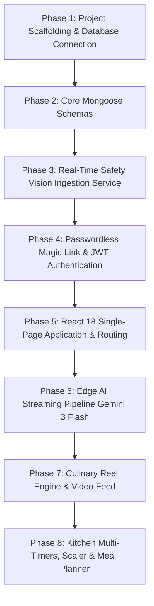

# Step 3: Step-by-Step Build Order

This guide provides a reproducible, step-by-step engineering sequence to rebuild the **Cooking Nexus** full-stack platform from an empty directory.

---

## 3.1 Overview of Construction Phases



---

## Phase 1: Project Initialization & Environment Setup

### 1. Initialize Node.js Root & Dependencies
```bash
mkdir cooking-nexus && cd cooking-nexus
npm init -y
npm install express@^5.2.1 mongoose@^8.23.0 dotenv@^17.3.1
npm install -D vitepress@^1.6.3 mermaid@^11.4.1 vitepress-plugin-mermaid@^2.0.17
```

### 2. Configure Environment Variables ([.env](file:///Users/avishjain/avishjain9-repos/26-cooking-nexus/.env))
```env
PORT=5000
MONGO_URI=mongodb://localhost:27017/magicAuthDB
JWT_SECRET=supersecretkey123
```

---

## Phase 2: Data Modeling with Mongoose

Create the schemas in `/models`:

### 1. Safety Incident Log Model ([models/SafetyLog.js](file:///Users/avishjain/avishjain9-repos/26-cooking-nexus/models/SafetyLog.js))
```javascript
const mongoose = require('mongoose');

const safetySchema = new mongoose.Schema({
  hazard: { type: String, required: true },
  level: { type: String, default: 'Low' }
}, { timestamps: true });

module.exports = mongoose.model('Safety', safetySchema);
```
- **Line 3**: Defines `hazard` as a required string (e.g., "Smoke Detected", "Unattended Burner").
- **Line 4**: Defaults severity level to "Low" unless escalated to "High" or "Critical".
- **Line 5**: `{ timestamps: true }` automatically generates indexed `createdAt` and `updatedAt` ISO dates.

### 2. User & Authentication Model ([models/User.js](file:///Users/avishjain/avishjain9-repos/26-cooking-nexus/models/User.js))
```javascript
const mongoose = require('mongoose');

const userSchema = new mongoose.Schema({
  email: { type: String, required: true, unique: true },
  lastLogin: { type: Date, default: Date.now }
});

module.exports = mongoose.model('User', userSchema);
```
- **Line 3**: Enforces uniqueness on the `email` field to prevent duplicate accounts and create an efficient unique index in MongoDB.

---

## Phase 3: Vision Hazard Ingestion Service

### 1. Vision Service Layer ([services/visionService.js](file:///Users/avishjain/avishjain9-repos/26-cooking-nexus/services/visionService.js))
```javascript
const Safety = require('../models/SafetyLog');

const analyze = async (data) => {
  return await Safety.create({ hazard: 'Smoke Detected', level: 'High' });
};

module.exports = { analyze };
```

### 2. Safety Controller ([controllers/safetyController.js](file:///Users/avishjain/avishjain9-repos/26-cooking-nexus/controllers/safetyController.js))
```javascript
const vision = require('../services/visionService');

const detect = async (req, res) => {
  try {
    const result = await vision.analyze(req.body);
    res.status(200).json(result);
  } catch (err) {
    res.status(500).json({ error: err.message });
  }
};

module.exports = { detect };
```

### 3. Server Entrypoint ([server.js](file:///Users/avishjain/avishjain9-repos/26-cooking-nexus/server.js))
```javascript
const express = require('express');
const app = express();
app.use(express.json());

const { detect } = require('./controllers/safetyController');
app.post('/api/vision', detect);

app.listen(5000, () => console.log('AI Vision Online'));
```

---

## Phase 4: Passwordless Magic Link Authentication

### 1. Auth Controller ([controllers/authController.js](file:///Users/avishjain/avishjain9-repos/26-cooking-nexus/controllers/authController.js))
```javascript
const User = require('../models/User');
const jwt = require('jsonwebtoken');

const requestLink = async (req, res) => {
  const { email } = req.body;
  const token = jwt.sign({ email }, process.env.JWT_SECRET, { expiresIn: '15m' });
  const magicLink = `http://localhost:5000/api/auth/verify?token=${token}`;
  console.log("Magic Link Generated:", magicLink);
  res.status(200).json({ message: "Check your console for the magic link!" });
};

const verifyLink = async (req, res) => {
  const { token } = req.query;
  try {
    const decoded = jwt.verify(token, process.env.JWT_SECRET);
    let user = await User.findOne({ email: decoded.email });
    if (!user) user = await User.create({ email: decoded.email });
    res.status(200).json({ message: "Login Successful", user });
  } catch (err) {
    res.status(401).json({ message: "Invalid or expired token" });
  }
};

module.exports = { requestLink, verifyLink };
```

---

## Phase 5: Edge AI Streaming Pipeline (Gemini 3 Flash)

### 1. Deno Edge Function ([supabase/functions/chef-ai/index.ts](file:///Users/avishjain/avishjain9-repos/26-cooking-nexus/27-kitchen-companion-pro/supabase/functions/chef-ai/index.ts))
```typescript
import { serve } from "https://deno.land/std@0.168.0/http/server.ts";

const corsHeaders = {
  "Access-Control-Allow-Origin": "*",
  "Access-Control-Allow-Headers": "authorization, x-client-info, apikey, content-type",
};

serve(async (req) => {
  if (req.method === "OPTIONS") return new Response(null, { headers: corsHeaders });
  
  const { messages, mode = "chat" } = await req.json();
  const response = await fetch("https://ai.gateway.lovable.dev/v1/chat/completions", {
    method: "POST",
    headers: {
      Authorization: `Bearer ${Deno.env.get("LOVABLE_API_KEY")}`,
      "Content-Type": "application/json",
    },
    body: JSON.stringify({
      model: "google/gemini-3-flash-preview",
      messages: [{ role: "system", content: "You are CookGrid's AI Chef..." }, ...messages],
      stream: true,
    }),
  });

  return new Response(response.body, {
    headers: { ...corsHeaders, "Content-Type": "text/event-stream" },
  });
});
```

### 2. Client SSE Consumer ([src/lib/ai-stream.ts](file:///Users/avishjain/avishjain9-repos/26-cooking-nexus/27-kitchen-companion-pro/src/lib/ai-stream.ts))
Uses `fetch()` with `response.body.getReader()` to decode incoming byte stream, buffer lines, extract `data: {"choices":[{"delta":{"content":"..."}}]}`, and invoke `onDelta()` for instantaneous UI rendering.

---

## Phase 6: React Frontend & Route Assembly

Create the Vite React app in `27-kitchen-companion-pro`:
1. **Setup App Layout**: Desktop navigation bar with brand logo and mobile bottom tab bar.
2. **Setup Protected Routes**: [src/components/ProtectedRoute.tsx](file:///Users/avishjain/avishjain9-repos/26-cooking-nexus/27-kitchen-companion-pro/src/components/ProtectedRoute.tsx) checking `useAuth()` session.
3. **Assemble Feature Views**:
   - `ReelsFeed.tsx`: Vertical video player with like counter and recipe drawer.
   - `RecipeDetail.tsx`: Dynamic portion multiplier and step progression.
   - `TimerPage.tsx`: Multi-stage Web Audio API kitchen timers.
   - `AiChatPage.tsx`: Markdown streaming chat interface.
