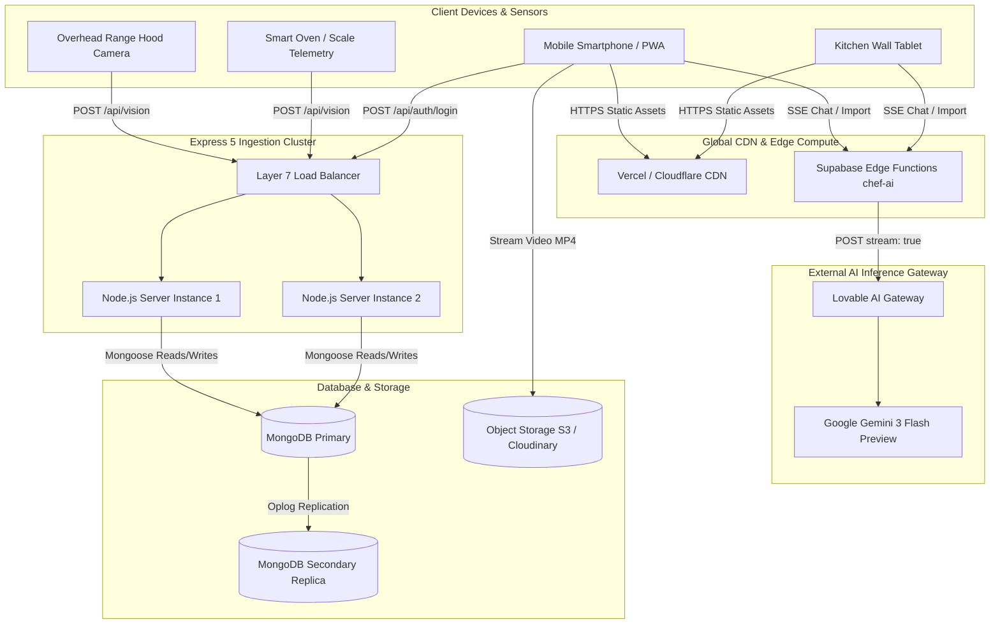
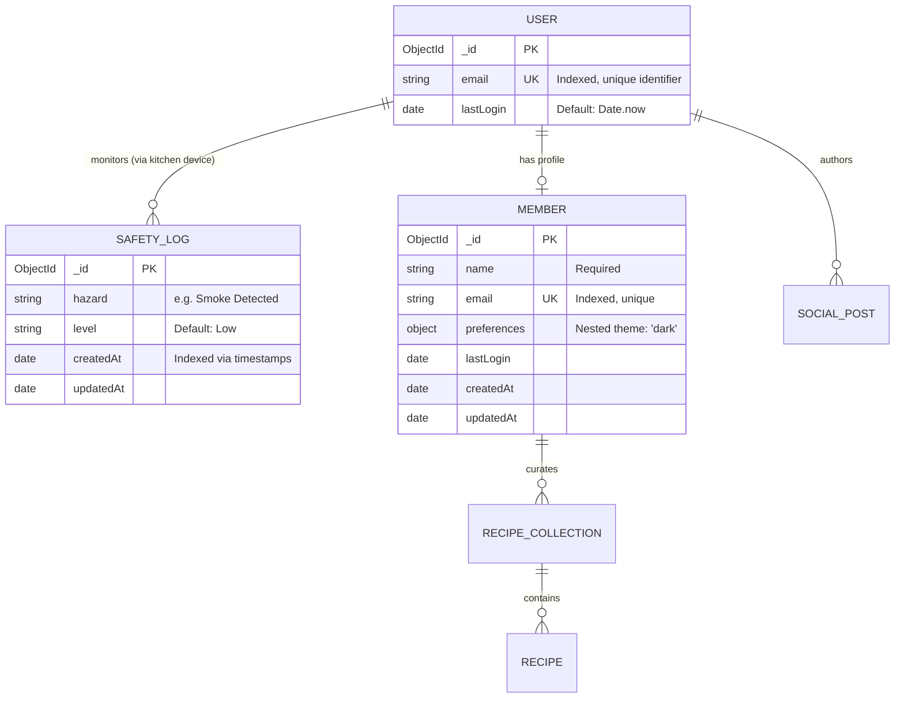
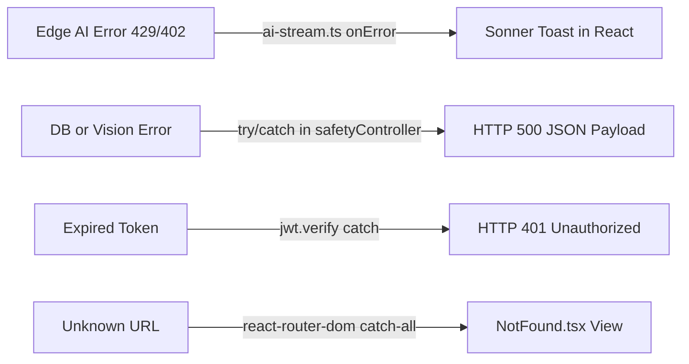

# Step 6: System Architecture & Data Flow

This document details the multi-tier distributed architecture of the Cooking Nexus platform, outlining request lifecycles, entity relationships, caching strategies, and 100x horizontal scaling patterns.

---

## 6.1 High-Level Architecture Topology

Cooking Nexus employs a **hybrid micro-modular edge architecture**:
1. **Edge Presentation & Ingestion Tier**: Single-Page React 18 client served via CDN with client-side routing, Web Audio timers, and local session caching.
2. **Serverless Edge AI Tier**: Deno-based Supabase Edge Functions proxying requests to Google's Gemini 3 Flash model via Server-Sent Events (SSE).
3. **Core Telemetry & Ingestion Tier**: High-throughput Express 5 Node.js service ingesting kitchen optical safety frames and issuing cryptographic JWT Magic Links.
4. **Data Persistence Tier**: MongoDB replica set storing user identity, member preference documents, and append-only safety incident logs.

---

## 6.2 Data Flow & Request Lifecycles

### 1. Kitchen Safety Hazard Lifecycle
1. The overhead range hood camera evaluates video frames. Upon detecting smoke or open flame patterns, it dispatches an HTTP POST request to `/api/vision` with a JSON payload containing `deviceId`, `hazard`, and `timestamp`.
2. The Express server passes the request through `express.json()` into [controllers/safetyController.js](file:///Users/avishjain/avishjain9-repos/26-cooking-nexus/controllers/safetyController.js).
3. The controller delegates to [services/visionService.js](file:///Users/avishjain/avishjain9-repos/26-cooking-nexus/services/visionService.js), which invokes `SafetyLog.create()`.
4. Mongoose validates the document schema and executes an insert into the `safeties` collection in MongoDB.
5. An HTTP 200 JSON confirmation with the generated MongoDB `_id` returns to the edge device.

### 2. Edge AI Streaming Chat Lifecycle
1. The user asks a cooking substitution question on `AiChatPage.tsx`.
2. `streamChat()` in [src/lib/ai-stream.ts](file:///Users/avishjain/avishjain9-repos/26-cooking-nexus/27-kitchen-companion-pro/src/lib/ai-stream.ts) opens a POST request with the message array and `mode: "chat"` to the edge function.
3. [supabase/functions/chef-ai/index.ts](file:///Users/avishjain/avishjain9-repos/26-cooking-nexus/27-kitchen-companion-pro/supabase/functions/chef-ai/index.ts) prepends the system prompt and forwards the payload to `https://ai.gateway.lovable.dev/v1/chat/completions` requesting `google/gemini-3-flash-preview` with `stream: true`.
4. As Gemini generates tokens, the Lovable gateway streams Server-Sent Events chunks (`data: {...}`).
5. The client `TextDecoder` processes newline-delimited chunks, decodes `delta.content`, and dispatches updates to the React component state, achieving instant token streaming.

---

## 6.3 Database Schema & Entity Relationships

### Database Indexes & Rationale
1. **`User.email`**: `{ email: 1 }, { unique: true }` — Enforces unique account constraints and provides O(1) lookup speed during Magic Link verification.
2. **`Member.email`**: `{ email: 1 }, { unique: true }` — Fast profile retrieval on login.
3. **`SafetyLog.createdAt`**: Indexed via `{ timestamps: true }` — Supports time-series queries for recent hazard audits and allows future TTL auto-expiry.

---

## 6.4 Caching & Error Handling Architecture

### Caching Layers
- **Browser Cache**: Static assets (Vite JS bundles, WebP food photography, fonts) are served with `Cache-Control: public, max-age=31536000, immutable`.
- **Client Server-State Cache**: TanStack React Query maintains an in-memory client cache (`staleTime: 5 minutes`), eliminating duplicate network requests when switching between `/app/recipes` and `/app/kitchen`.
- **Planned Redis Layer**: Frequently accessed member profiles and active recipe JSON objects will be cached in Redis with a 15-minute TTL.

### Error Handling Across Layers

---

## 6.5 Scaling to 100x Traffic & First 3 Bottlenecks

### Current vs 100x Workload Projections
- **Current Load**: ~10 req/sec; 100 daily active kitchens; ~50k AI tokens/day.
- **100x Load**: ~1,000 req/sec; 10,000 concurrent cooking sessions; ~5M AI tokens/day; ~15 Gbps video reel streaming bandwidth.

### Top 3 Bottlenecks & Remediation Plan

#### Bottleneck 1: Synchronous Vision Ingestion Writes to MongoDB
- *Problem*: At 1,000 frames/sec, opening direct Mongoose connections for every `/api/vision` POST will exhaust MongoDB connection pools and cause thread starvation in Express.
- *Remediation*: Introduce a distributed message queue (RabbitMQ or Apache Kafka) or Redis Streams in front of the database. The `/api/vision` endpoint immediately pushes to the queue and responds `HTTP 202 Accepted` in <5ms, while background worker processes batch-insert logs into MongoDB.

#### Bottleneck 2: External AI Gateway Concurrency & Rate Limits
- *Problem*: Lovable/Gemini rate limits (HTTP 429) will throttle concurrent users during peak dinner prep hours (6 PM - 8 PM).
- *Remediation*: Implement a semantic cache in Redis using Vector Embeddings. If a user asks "How do I substitute buttermilk in pancakes?", and that query has already been answered with high cosine similarity, serve the cached response instantly without calling the external LLM.

#### Bottleneck 3: Video Reel Bandwidth & Storage Egress
- *Problem*: Serving high-definition culinary reels directly from a single web origin will saturate network interfaces and incur catastrophic egress costs.
- *Remediation*: Store source MP4 assets in Cloudflare R2 / AWS S3 and distribute video manifests via AWS CloudFront CDN with HLS adaptive bitrate streaming (HLS/DASH), reducing origin egress to near zero.
