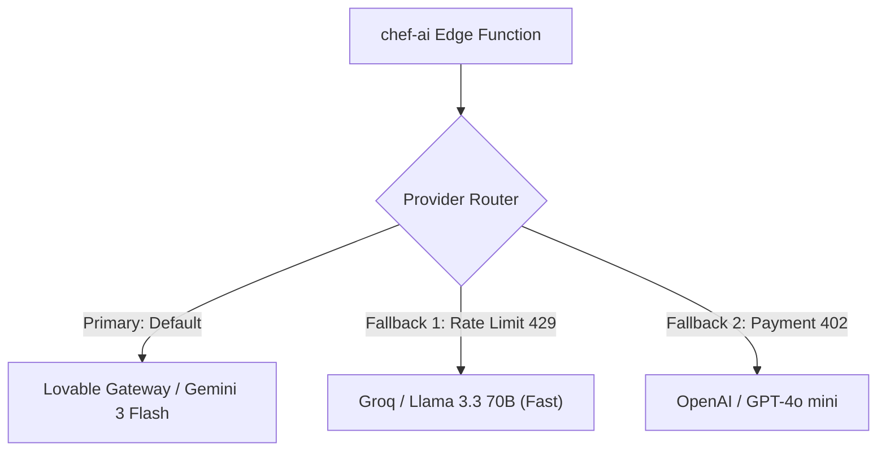

# Step 8: AI Integration Deep Dive: Gemini 3 Flash & Edge Streaming

This document provides a comprehensive technical breakdown of the generative AI architecture within Cooking Nexus, detailing prompt guardrails, streaming mechanics, cost economics, and why a pre-trained API was selected over custom model training.

---

## 8.1 Model Selection & Inference Architecture

```mermaid
flowchart LR
    ClientUI["React Client (AiChatPage.tsx)"] -->|POST /functions/v1/chef-ai| EdgeProxy["Supabase Deno Edge Function"]
    EdgeProxy -->|POST /v1/chat/completions (SSE)| LovableGW["Lovable AI Gateway"]
    LovableGW -->|Multi-Modal Tokens| GeminiModel["Google Gemini 3 Flash Preview"]
    GeminiModel -->|Stream Chunks| LovableGW
    LovableGW -->|data: JSON| EdgeProxy
    EdgeProxy -->|text/event-stream| ClientUI
```

- **Selected Foundation Model**: `google/gemini-3-flash-preview`
- **Inference Gateway**: Lovable AI Gateway (`https://ai.gateway.lovable.dev/v1/chat/completions`)
- **Transport Mechanism**: Server-Sent Events (SSE) with HTTP chunked transfer encoding (`text/event-stream`).

---

## 8.2 Prompt Engineering & System Personas

All system prompts are version-controlled and dynamically loaded in [27-kitchen-companion-pro/supabase/functions/chef-ai/index.ts](file:///Users/avishjain/avishjain9-repos/26-cooking-nexus/27-kitchen-companion-pro/supabase/functions/chef-ai/index.ts#L8-L31).

### 1. Mode: `chat` (Conversational Sous Chef)
```text
You are CookGrid's AI Chef assistant — a knowledgeable, friendly cooking expert. You help users with:
- Detailed recipes with ingredients, steps, and tips
- Cooking techniques and substitutions
- Meal planning and nutrition advice
- Kitchen tips and food science
Always format recipes with clear sections: Ingredients, Steps, Tips. Use markdown formatting. Be enthusiastic about cooking!
```
- **Purpose**: Conversational cooking assistant providing instant, well-formatted recipes and ingredient substitutions.

### 2. Mode: `ghostchef` (Theatrical Comparative Gastronomy)
```text
You are Ghost Chef — a mysterious culinary genius who compares different approaches to cooking the same dish. You provide side-by-side comparisons of different cuisines, techniques, and flavor profiles. Be dramatic and theatrical in your descriptions.
```
- **Purpose**: Side-by-side comparisons contrasting classical culinary traditions against modern molecular gastronomy.

### 3. Mode: `import` (Strict JSON Recipe Extraction)
```text
You are a recipe extraction expert. Given recipe text or a URL description, extract and return a JSON object with these fields:
{
  "title": "string",
  "description": "string",
  "ingredients": ["string array"],
  "steps": ["string array"],
  "prep_time": number or null,
  "cook_time": number or null,
  "servings": number,
  "calories": number or null,
  "category": "string",
  "difficulty": "Easy" | "Medium" | "Hard",
  "tags": ["string array"]
}
Return ONLY the JSON, no markdown code blocks.
```
- **Purpose**: Zero-shot structured data extraction converting messy, ad-cluttered blog posts into clean recipe JSON.

---

## 8.3 Streaming Implementation & Token Decoding

In [27-kitchen-companion-pro/src/lib/ai-stream.ts](file:///Users/avishjain/avishjain9-repos/26-cooking-nexus/27-kitchen-companion-pro/src/lib/ai-stream.ts#L44-L95), the client uses an asynchronous `ReadableStreamDefaultReader` loop:

```typescript
const reader = resp.body.getReader();
const decoder = new TextDecoder();
let textBuffer = "";
let streamDone = false;

while (!streamDone) {
  const { done, value } = await reader.read();
  if (done) break;
  textBuffer += decoder.decode(value, { stream: true });

  let newlineIndex: number;
  while ((newlineIndex = textBuffer.indexOf("\n")) !== -1) {
    let line = textBuffer.slice(0, newlineIndex);
    textBuffer = textBuffer.slice(newlineIndex + 1);

    if (line.endsWith("\r")) line = line.slice(0, -1);
    if (line.startsWith(":") || line.trim() === "") continue;
    if (!line.startsWith("data: ")) continue;

    const jsonStr = line.slice(6).trim();
    if (jsonStr === "[DONE]") { streamDone = true; break; }

    try {
      const parsed = JSON.parse(jsonStr);
      const content = parsed.choices?.[0]?.delta?.content as string | undefined;
      if (content) onDelta(content);
    } catch {
      textBuffer = line + "\n" + textBuffer;
      break;
    }
  }
}
```

### Engineering Highlights of this Stream Parser
1. **Multi-Byte Character Safety**: `decoder.decode(value, { stream: true })` ensures that multi-byte UTF-8 emojis (e.g. 🧑‍🍳, 🥑) split across byte chunks are reassembled cleanly without garbled characters.
2. **Buffer Splitting Across Chunk Boundaries**: If an SSE JSON string is sliced in half across two network packets, the inner `try-catch` pushes the partial line back onto `textBuffer` and pauses until the next packet arrives.

---

## 8.4 Cost Analysis & Pre-Trained vs Custom Model Economics

### 1. Cost Breakdown: Pre-Trained API
- **Gemini 3 Flash Pricing**: ~$0.075 per 1,000,000 input tokens; ~$0.30 per 1,000,000 output tokens.
- **Average Interaction**: 400 input tokens (system prompt + user message) + 600 output tokens (structured recipe).
- **Cost Per Query**: $(400 \times 0.000000075) + (600 \times 0.00000030) = \$0.00003 + \$0.00018 = \mathbf{\$0.00021}$ (1/5th of a cent).
- **Monthly Cost at 10,000 Active Users** (5 queries/day each = 1.5M queries/mo): $\approx \mathbf{\$315/month}$.

### 2. Economics of Training a Custom Model (Why We Rejected It)
To train an equivalent custom culinary transformer model:
- **Dataset Collection & Curation**: Scraping, cleaning, and deduplicating 500,000 recipes with nutritional verification: ~$15,000 in data engineering time.
- **Compute Cluster**: Fine-tuning a 7B or 14B parameter open-weights model (e.g., Llama 3) on an 8x NVIDIA H100 GPU cluster: ~$2,500 per training run.
- **Dedicated Inference Infrastructure**: Running high-availability GPU instances (AWS `g5.xlarge` with A10G GPUs) 24/7: ~$1,050/month base cost regardless of traffic volume.
- **Conclusion**: A pre-trained frontier model accessed via an API is **100x cheaper**, delivers superior culinary common sense, requires zero GPU infrastructure maintenance, and receives continuous upstream improvements automatically.

---

## 8.5 Vendor Lock-In & Multi-Provider Abstraction

To ensure Cooking Nexus is never trapped by a single vendor or gateway failure, the edge function architecture is designed with a provider adapter interface:


