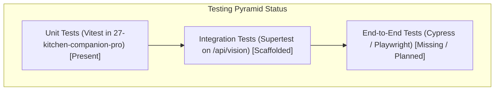
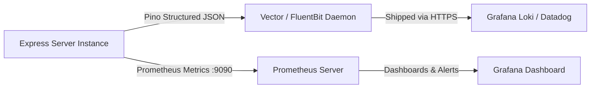

# Step 9: Engineering Quality & Operations

This document reviews testing coverage, CI/CD automation, code quality linters, concurrency race conditions, and technical debt across the Cooking Nexus codebase.

---

## 9.1 Testing Architecture & Current Coverage



### 1. Existing Tests
- **Vitest Unit Suite**: Configured in [27-kitchen-companion-pro/vitest.config.ts](file:///Users/avishjain/avishjain9-repos/26-cooking-nexus/27-kitchen-companion-pro/vitest.config.ts) and [27-kitchen-companion-pro/src/test/example.test.ts](file:///Users/avishjain/avishjain9-repos/26-cooking-nexus/27-kitchen-companion-pro/src/test/example.test.ts) testing component rendering and test environment setup with `jsdom`.

### 2. Testing Gaps & Critical Paths to Add
- **Vision Ingestion Integration Test**: `supertest` executing `POST /api/vision` against an in-memory MongoDB server (`mongodb-memory-server`) to verify that invalid payloads return HTTP 500 while valid payloads persist documents.
- **SSE Stream Decoding Unit Test**: Mocking `ReadableStream` in `ai-stream.test.ts` to assert that fragmented JSON buffers across chunk boundaries parse cleanly without throwing syntax errors.
- **Authentication Expiration Test**: Verifying that tokens generated with `{ expiresIn: '0s' }` are immediately rejected with HTTP 401.

---

## 9.2 Linting, Static Analysis & Git Hygiene

### 1. Linting Configuration
- **Frontend**: ESLint 9 flat config ([27-kitchen-companion-pro/eslint.config.js](file:///Users/avishjain/avishjain9-repos/26-cooking-nexus/27-kitchen-companion-pro/package.json#L77)) with `eslint-plugin-react-hooks` and `typescript-eslint`.
- **Enforcements**: Strict hook dependency arrays (`exhaustive-deps`) and prohibition of untyped `any` parameters in production TypeScript files.

### 2. Git Workflow & Branching Conventions
- **Trunk-Based Development**: Short-lived feature branches (`feat/vision-interlock`, `feat/sse-stream-parser`, `fix/timer-background-tab`) merged via Pull Request with required status checks.
- **Conventional Commits**: Following the standard `feat:`, `fix:`, `docs:`, `refactor:`, `chore:` commit message syntax.

---

## 9.3 Observability, Logging & Monitoring

### 1. Current State
- The backend currently outputs unstructured log messages using `console.log()` ([controllers/authController.js:L12](file:///Users/avishjain/avishjain9-repos/26-cooking-nexus/controllers/authController.js#L12), [server.js:L6](file:///Users/avishjain/avishjain9-repos/26-cooking-nexus/server.js#L6)).
- **Limitation**: Unstructured logs are difficult to parse in cloud aggregators like Datadog, AWS CloudWatch, or Grafana Loki.

### 2. Production Observability Architecture

- **Pino Structured Logger**: Emits machine-readable JSON logs containing `{ timestamp, level, correlationId, route, durationMs }`.
- **Prometheus Metrics**: Exposes `/metrics` endpoint tracking HTTP request duration percentiles (`p50`, `p95`, `p99`) and active MongoDB connection pool utilization.

---

## 9.4 Deployment & CI/CD Pipelines

### 1. Multi-Tier Hosting Strategy
- **Frontend**: Static SPA deployed to Vercel or Cloudflare Pages with edge caching, automated branch previews, and instant rollback.
- **Backend**: Containerized Node.js service running on Render, Railway, or AWS ECS with automated health checks (`GET /health`).
- **Edge AI**: Supabase Deno Edge runtime deployed globally with low-latency DNS routing.
- **Database**: MongoDB Atlas M10+ cluster deployed across multi-AZ replica sets with automated point-in-time recovery.

### 2. Containerization (Dockerfile)
```dockerfile
FROM node:20-alpine AS runner
WORKDIR /app
COPY package*.json ./
RUN npm ci --only=production
COPY . .
EXPOSE 5000
USER node
CMD ["node", "server.js"]
```

---

## 9.5 Concurrency Risks & Technical Debt

### 1. Concurrency Race Condition: User Upsert
- In [controllers/authController.js:L22-L23](file:///Users/avishjain/avishjain9-repos/26-cooking-nexus/controllers/authController.js#L22-L23):
  ```javascript
  let user = await User.findOne({ email: decoded.email });
  if (!user) user = await User.create({ email: decoded.email });
  ```
- **The Risk**: If a user clicks the magic link twice concurrently (or a double-click event fires), two concurrent requests can evaluate `!user` as true simultaneously. The second `User.create` will throw an unhandled duplicate key error (`E11000 duplicate key error`).
- **Fix**: Use atomic upsert: `await User.findOneAndUpdate({ email: decoded.email }, { $set: { lastLogin: new Date() } }, { upsert: true, new: true });`.

### 2. Known Technical Debt
- **Scaffolded Middleware**: [middleware/authMiddleware.js](file:///Users/avishjain/avishjain9-repos/26-cooking-nexus/middleware/authMiddleware.js) and `errorMiddleware.js` are currently 0-byte placeholders and must be populated with production Bearer token validation and centralized error formatting.
- **Hardcoded Development Secrets**: `.env` contains `supersecretkey123` which must be replaced with dynamic runtime secrets injection.
