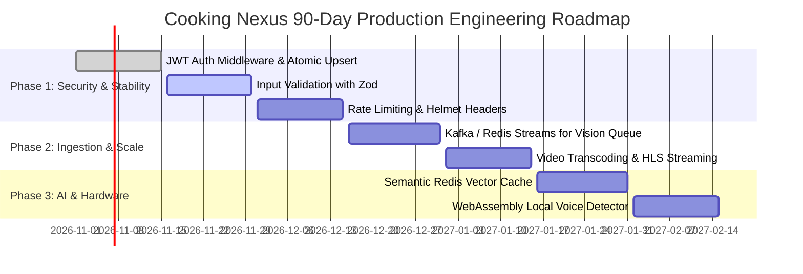

# Step 11: Gaps, Production Hardening & Roadmap

This document outlines the current architectural gaps, missing production safeguards, and prioritized engineering improvements for the Cooking Nexus platform.

---

## 11.1 Prioritized Gaps & Remediation Matrix

| Rank | Engineering Area | Current Limitation in Code | Production Risk / Interview Attack | Recommended Fix & Code Snippet |
|---|---|---|---|---|
| **1** | **Backend Auth Middleware** | [middleware/authMiddleware.js](file:///Users/avishjain/avishjain9-repos/26-cooking-nexus/middleware/authMiddleware.js) is a 0-byte file. Endpoints like `/api/members/:id` have no token check. | Any user can query another member's profile by guessing their MongoDB `_id`. | Implement JWT Bearer token validation middleware extracting `req.headers.authorization`. |
| **2** | **Atomic User Upsert** | [controllers/authController.js:L22-L23](file:///Users/avishjain/avishjain9-repos/26-cooking-nexus/controllers/authController.js#L22-L23) uses non-atomic `findOne` followed by `create`. | Concurrency race condition on rapid clicks triggers `E11000 duplicate key error`. | Replace with atomic `User.findOneAndUpdate({ email }, { $set: { lastLogin: new Date() } }, { upsert: true, new: true })`. |
| **3** | **Input Schema Validation** | `/api/vision` passes raw `req.body` to `visionService.analyze` without schema sanitization. | Malicious payloads can inject unescaped MongoDB operators or corrupt documents. | Add Zod or Joi middleware: `const visionSchema = z.object({ deviceId: z.string(), hazard: z.string() })`. |
| **4** | **Rate Limiting** | `/api/auth/login` and `/api/vision` have no request rate limiters. | Attackers can flood the endpoint to exhaust memory or trigger denial of service on mailer queues. | Add `express-rate-limit`: limit login requests to 5 per IP per 15 minutes. |
| **5** | **Structured Logging** | Backend uses unstructured `console.log()` ([authController.js:L12](file:///Users/avishjain/avishjain9-repos/26-cooking-nexus/controllers/authController.js#L12)). | Unstructured text cannot be indexed or alerted on in cloud logging aggregators like Datadog. | Integrate `pino` or `winston` for structured JSON logs with correlation IDs. |
| **6** | **Session Security** | Frontend stores session tokens in `localStorage` ([AuthContext.tsx:L40](file:///Users/avishjain/avishjain9-repos/26-cooking-nexus/27-kitchen-companion-pro/src/contexts/AuthContext.tsx#L40)). | Vulnerable to token theft via Cross-Site Scripting (XSS). | Migrate session cookies to `httpOnly`, `Secure`, `SameSite=Strict`. |
| **7** | **Integration Tests** | Root backend has no automated Supertest integration tests for `/api/vision` and `/api/auth`. | Regressions in route handlers or schema definitions go undetected until runtime. | Add Supertest and `mongodb-memory-server` test suites in `tests/api.test.js`. |
| **8** | **Email Dispatch Integration**| Magic links are logged to the console ([authController.js:L12](file:///Users/avishjain/avishjain9-repos/26-cooking-nexus/controllers/authController.js#L12)) rather than dispatched via SMTP. | Users cannot log in on remote production environments. | Integrate Resend, SendGrid, or AWS SES to dispatch HTML verification emails. |

---

## 11.2 90-Day Production Roadmap

