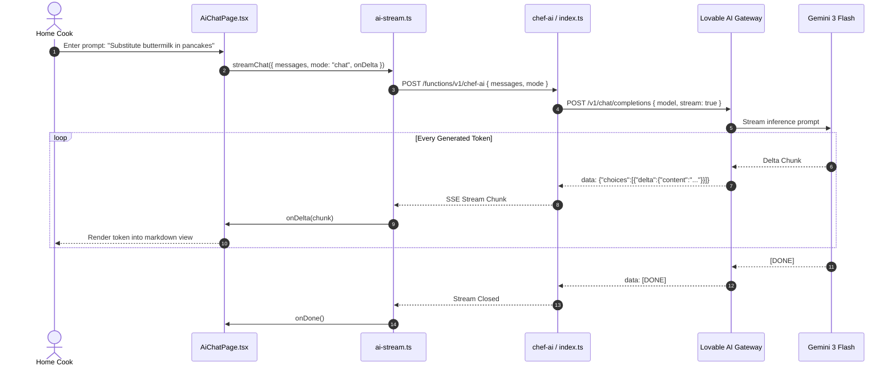

# F1: AI Generative Chef & Structured Recipe Extraction

## 1. Overview & User Experience
The **AI Generative Chef** provides two essential culinary capabilities:
1. **Interactive Conversational Cooking Assistant**: Users ask cooking questions, request ingredient substitutions, or ask for meal ideas based on what's in their pantry. Responses stream in real time as formatted markdown with ingredients, preparation steps, and chef tips.
2. **AI Recipe Importer**: Users paste unstructured recipe text from blogs or social media. The model extracts preparation times, cook times, servings, difficulty ratings, categories, and ingredients into a structured JSON schema.

---

## 2. Technical Architecture & Data Flow

```mermaid
flowchart TD
    User([Home Cook / Chef]) -->|Types prompt / pastes text| Page[AiChatPage.tsx / RecipeImportPage.tsx]
    Page -->|Calls streamChat| Client[lib/ai-stream.ts]
    Client -->|POST /functions/v1/chef-ai| Edge[chef-ai/index.ts (Deno)]
    Edge -->|Injects system prompt| Gateway[Lovable AI Gateway]
    Gateway -->|stream: true| Gemini[Google Gemini 3 Flash Preview]
    Gemini -->|Token deltas| Gateway
    Gateway -->|SSE stream data: JSON| Edge
    Edge -->|text/event-stream| Client
    Client -->|onDelta token dispatch| Page
    Page -->|Incremental UI render| User
```

---

## 3. End-to-End Request Sequence



---

## 4. Code Implementation Trace

### Client Streaming Engine ([27-kitchen-companion-pro/src/lib/ai-stream.ts](file:///Users/avishjain/avishjain9-repos/26-cooking-nexus/27-kitchen-companion-pro/src/lib/ai-stream.ts#L18-L98))
- **`streamChat(options)`**: Establishes `fetch()` POST to `${VITE_SUPABASE_URL}/functions/v1/chef-ai`.
- **Response Handling**:
  - Checks `resp.status === 429` (Rate limit) and `resp.status === 402` (Payment/credits exhausted).
  - Obtains `resp.body.getReader()` and streams byte chunks through `TextDecoder`.
  - Splits incoming buffer on newlines (`\n`), strips carriage returns (`\r`), extracts `data: ` payloads.
  - Detects `[DONE]` marker to cleanly end stream.
  - Reassembles fragmented JSON chunks across read boundaries.

### Edge Function Logic ([27-kitchen-companion-pro/supabase/functions/chef-ai/index.ts](file:///Users/avishjain/avishjain9-repos/26-cooking-nexus/27-kitchen-companion-pro/supabase/functions/chef-ai/index.ts#L8-L90))
- **System Prompts**:
  - `chat`: Knowledgeable culinary expert formatting markdown sections (Ingredients, Steps, Tips).
  - `ghostchef`: Mysterious culinary genius delivering theatrical, side-by-side culinary comparisons.
  - `import`: Strict JSON extractor returning `{ title, description, ingredients, steps, prep_time, cook_time, servings, calories, category, difficulty, tags }` with no markdown code blocks.
- **Upstream Forwarding**: Dispatches payload to `https://ai.gateway.lovable.dev/v1/chat/completions` using model `google/gemini-3-flash-preview`.

---

## 5. Failure Path & Resilience
- **Network Disconnect**: Catches fetch stream errors and triggers `onError("Connection failed")`.
- **Rate Limit (429)**: Returns clean message: *"Rate limit reached. Please wait a moment and try again."*
- **Credit Depletion (402)**: Returns message: *"AI credits exhausted. Please add funds."*
- **JSON Parse Failure on Chunk**: Incomplete SSE lines are retained in `textBuffer` for the next chunk read rather than throwing an unhandled exception.

---

## 6. Say It Out Loud (Spoken Explanation)

"I built the AI Chef Assistant to give users hands-free cooking guidance and to automatically convert messy recipe text from websites into clean, structured data. When a user asks a cooking question in `AiChatPage`, the frontend calls `streamChat` in `ai-stream.ts`, which opens a POST connection to our Deno edge function at `/functions/v1/chef-ai`. The edge function attaches a tailored system prompt and forwards the request to Google's Gemini 3 Flash model via the Lovable gateway with streaming enabled. As tokens arrive in Server-Sent Events, my client-side reader parses the JSON chunks using a `TextDecoder` and immediately streams the text into the React component, eliminating any loading wait.

I chose this pre-trained API streaming approach over training our own culinary model because training a custom transformer would have cost tens of thousands of dollars in GPU compute and required months of dataset curation, whereas Gemini 3 Flash delivers sub-second latency and excellent culinary knowledge right out of the box. If the AI gateway returns a 429 rate limit or 402 payment error, my stream handler catches it immediately and displays a friendly error banner rather than leaving the chat hanging. One limitation right now is that the edge function doesn't persist the chat history to a database, so conversations reset on page refresh, which I plan to solve by storing message threads in Supabase PostgreSQL tables."
