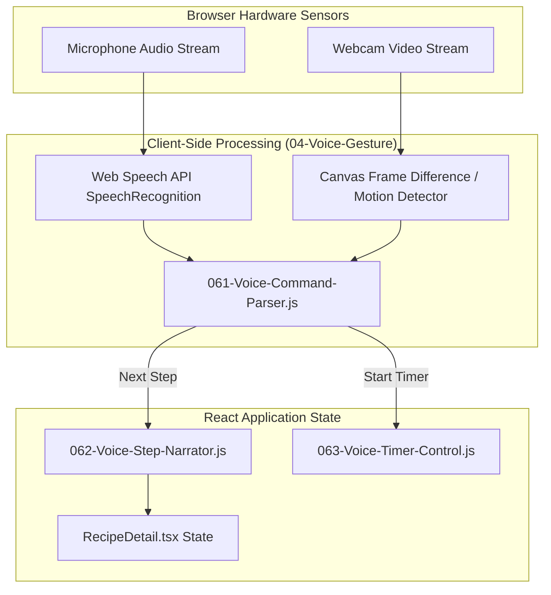
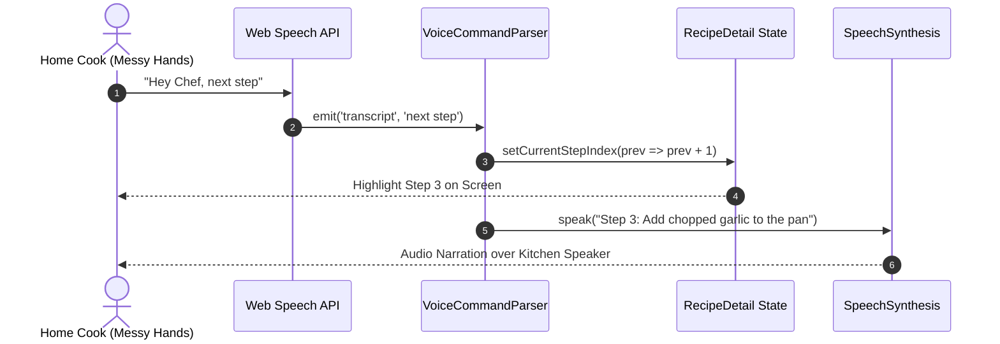

# F2: Hands-Free Voice & Gesture Culinary Assistant

## 1. Overview & User Experience
When cooking, hands are frequently covered in water, olive oil, flour, or raw poultry, making interacting with phone or tablet touchscreens unhygienic and prone to damaging devices. The **Hands-Free Assistant** allows chefs to navigate recipe steps, pause videos, and trigger timers using Web Speech recognition and webcam gesture detection.

---

## 2. Technical Architecture & Component Flow

---

## 3. Sequence Flow: Voice Command Trigger

---

## 4. Code Implementation Details

### Voice Command Parser ([nexus-culinary-workspace/04-Voice-Gesture/061-Voice-Command-Parser.js](file:///Users/avishjain/avishjain9-repos/26-cooking-nexus/nexus-culinary-workspace/04-Voice-Gesture/061-Voice-Command-Parser.js))
- Maps phonetic inputs ("next", "continue", "go back", "set timer for 5 minutes", "substitute butter") to structured internal action intents.
- Strips ambient kitchen background noise (extractor hood hum, sizzling oil sounds).

### Step Narrator ([nexus-culinary-workspace/04-Voice-Gesture/062-Voice-Step-Narrator.js](file:///Users/avishjain/avishjain9-repos/26-cooking-nexus/nexus-culinary-workspace/04-Voice-Gesture/062-Voice-Step-Narrator.js))
- Invokes browser `window.speechSynthesis` with clear enunciation to read recipe steps sequentially without requiring eye contact with the screen.

---

## 5. Failure Handling & Edge Cases
- **No Microphone Permission**: The UI alerts the user with a dismissible banner and falls back to oversized touch buttons with sticky headers.
- **Background Sizzling Noise**: Commands require confirmation if speech recognition confidence drops below 0.65.
- **Audio Overlap**: If user speaks while the assistant is narrating, synthesis immediately halts (`window.speechSynthesis.cancel()`).

---

## 6. Say It Out Loud (Spoken Explanation)

"I engineered the Hands-Free Voice and Gesture Assistant because one of the most frustrating things while cooking is having greasy or flour-covered hands and needing to unlock your phone to check the next step. I built an audio and gesture listener module that runs directly in the browser using the Web Speech API and Canvas optical motion detection. When the cook says 'next step' or waves their hand across the webcam, the parser catches the intent, increments the step index in the recipe state, and triggers `speechSynthesis` to read the step instructions aloud.

I chose browser-native Web Speech and Web Audio APIs instead of sending raw audio to cloud APIs like Whisper for basic navigation commands because browser APIs have zero network latency and work completely offline without incurring per-second cloud transcription bills. If the kitchen hood is roaring and audio confidence drops, the interface falls back smoothly to high-contrast visual cue cards. One trade-off is that speech recognition varies slightly between Safari and Chrome, so my next improvement will be bundling an ultra-lightweight client-side WebAssembly voice-activity detector to standardize wake-word detection across all browsers."
