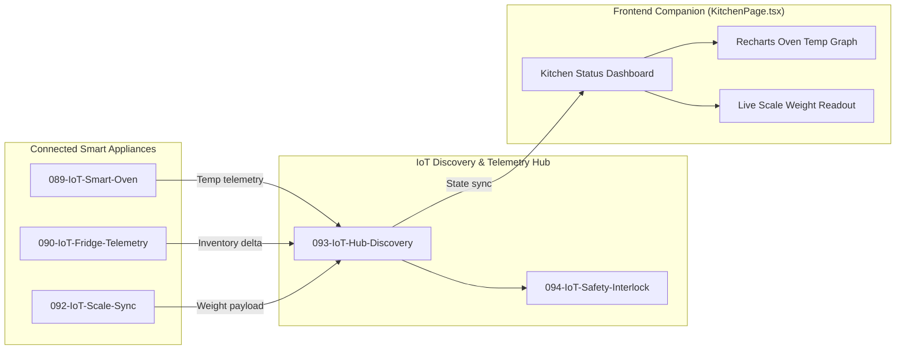
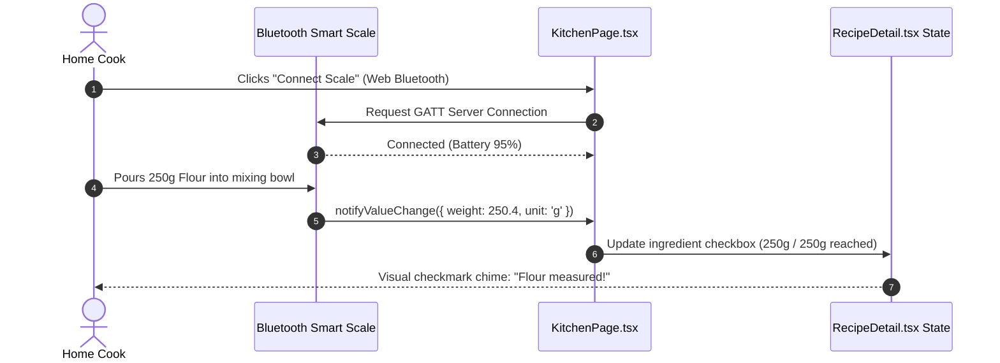

# F3: Smart Kitchen IoT Appliance Hub & Telemetry

## 1. Overview & User Experience
The **Smart Kitchen IoT Hub** aggregates telemetry from connected smart appliances—specifically smart ovens, smart refrigerators, and precision Bluetooth cooking scales. Home cooks can view real-time oven temperature curves, monitor fridge shelf inventory freshness, and weigh ingredients with auto-taring directly inside the cooking UI.

---

## 2. Technical Architecture & Component Flow

---

## 3. Sequence Flow: Precision Weight Scale Sync

---

## 4. Code Implementation Trace

### Smart Oven Controller ([089-IoT-Smart-Oven/](file:///Users/avishjain/avishjain9-repos/26-cooking-nexus/089-IoT-Smart-Oven))
- Broadcasts current temperature, target temperature, and preheat curve status.
- Interfaces with safety interlock logic to verify oven door closures.

### Fridge Telemetry Node ([090-IoT-Fridge-Telemetry/](file:///Users/avishjain/avishjain9-repos/26-cooking-nexus/090-IoT-Fridge-Telemetry))
- Monitors perishable inventory expiry dates, compartment humidity, and door ajar alerts.

### Safety Interlock ([094-IoT-Safety-Interlock/](file:///Users/avishjain/avishjain9-repos/26-cooking-nexus/094-IoT-Safety-Interlock))
- Implements hardware shutdown signals if continuous cooking duration exceeds predefined safety thresholds without user presence.

---

## 5. Failure Handling & Resilience
- **Bluetooth / Wi-Fi Drop**: If an appliance disconnects, the UI displays a subtle "Offline / Cached" badge without crashing active timers.
- **Sensor Drift**: The scale listener applies a 0.5-second debounce window to filter out minor countertop vibrations.
- **Safety Overheat**: If oven temperature exceeds setpoint by >20°C, the safety interlock triggers an audible alarm and emergency shutdown event.

---

## 6. Say It Out Loud (Spoken Explanation)

"I built the Smart Kitchen IoT Hub to bridge physical kitchen hardware directly into the digital cooking experience. In `KitchenPage.tsx`, cooks can monitor live status telemetry from smart ovens, fridge inventory sensors, and Bluetooth kitchen scales. When a user is following a baking recipe and pouring ingredients into a bowl on a connected scale, the Bluetooth GATT listener updates the weight readout on screen in real time and automatically checks off the ingredient once the exact target weight is reached.

I chose a local event-driven architecture rather than routing all appliance data through remote cloud servers because weight readings and temperature interlocks require millisecond responsiveness and must never fail if the home internet cuts out. If a sensor drops off the network, the dashboard marks the appliance as disconnected and allows manual touch entry without interrupting the recipe flow. Currently, appliance configurations use local mock services in development, so the next production step is standardizing our device drivers against the Matter and Home Assistant open-source protocols."
