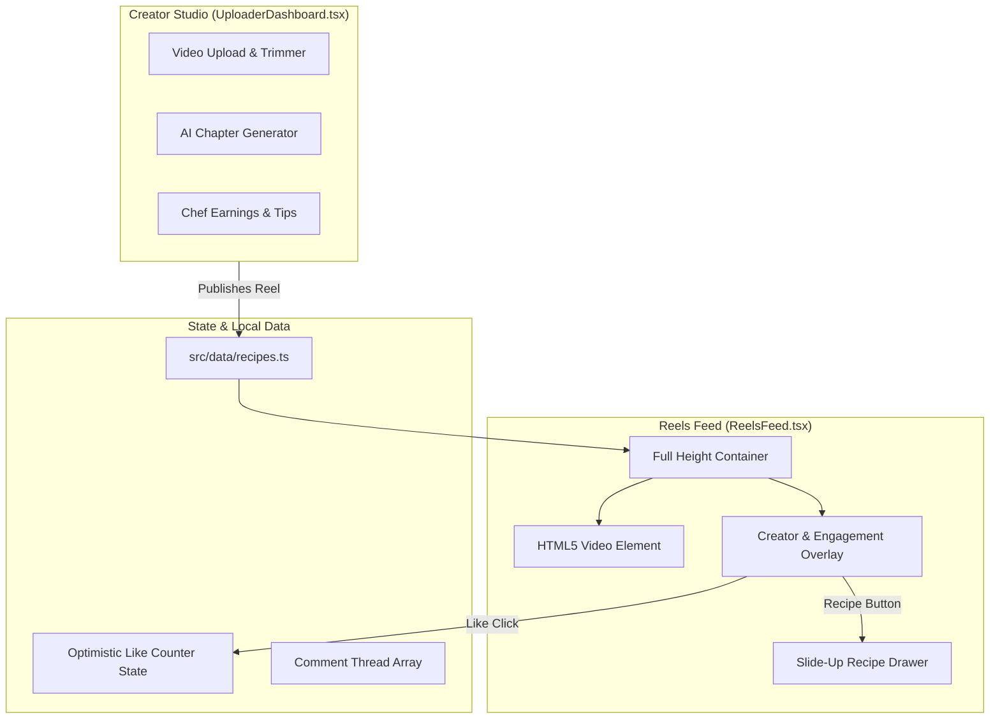
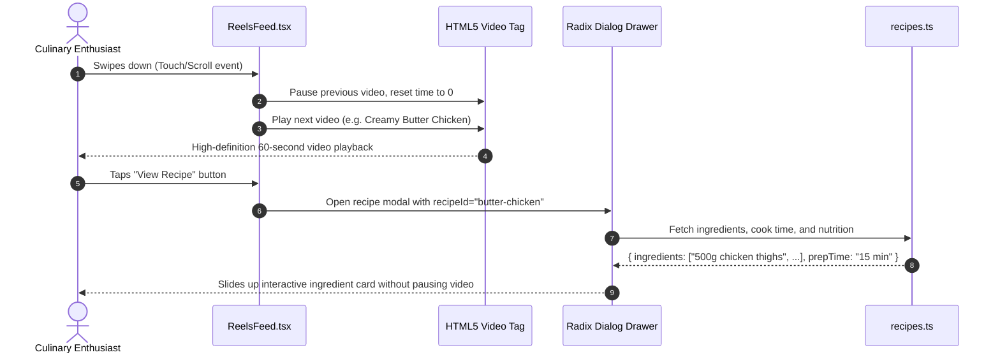

# F4: Culinary Reel Engine & Creator Social Stream

## 1. Overview & User Experience
Food discovery has evolved from long text blogs into rapid, visual 60-second video reels. The **Culinary Reel Engine** provides a full-screen, vertical swipeable video player tailored specifically for food creators and hungry viewers, integrating interactive recipe cards directly over the video stream.

---

## 2. Technical Architecture & Component Flow

---

## 3. Sequence Flow: Swipe Reel & Recipe Drawer Trigger

---

## 4. Code Implementation Trace

### Reel Feed View ([27-kitchen-companion-pro/src/pages/ReelsFeed.tsx](file:///Users/avishjain/avishjain9-repos/26-cooking-nexus/27-kitchen-companion-pro/src/pages/ReelsFeed.tsx))
- Renders responsive full-viewport vertical cards with snap scrolling CSS (`scroll-snap-type: y mandatory`).
- Implements optimistic UI state for instant like heart animations (`likes_count + 1`).
- Uses `@radix-ui/react-dialog` for accessible, zero-jank slide-up drawers.

### Curated Recipe Dataset ([27-kitchen-companion-pro/src/data/recipes.ts](file:///Users/avishjain/avishjain9-repos/26-cooking-nexus/27-kitchen-companion-pro/src/data/recipes.ts#L34-L126))
- Contains 10 seed culinary reels: Creamy Butter Chicken, Hawaiian Tuna Poke Bowl, Neapolitan Margherita Pizza, Chocolate Molten Lava Cake, Traditional Pad Thai, Vibrant Acai Smoothie Bowl, Crispy Salmon Fillet, Green Detox Smoothie, Reverse-Seared Ribeye Steak, and Deluxe Sushi Platter.

---

## 5. Failure Handling & Performance
- **Video Buffer Stalling**: Displays an animated low-profile spinner and falls back to pre-rendered JPEG poster assets.
- **Memory Management**: Off-screen video nodes are automatically paused to prevent GPU memory saturation on mobile Safari.
- **Audio Autoplay Block**: Mutes video by default on first load to comply with browser autoplay policies, providing an unmute overlay pill.

---

## 6. Say It Out Loud (Spoken Explanation)

"I built the Culinary Reel Engine in `ReelsFeed.tsx` to give users an engaging, TikTok-style browsing experience focused exclusively on fast, high-quality cooking tutorials. As the user swipes through videos, the feed renders full-height video containers displaying the creator's avatar, dish title, duration, and social metrics. Users can like videos with instantaneous optimistic UI updates, open a comment drawer, or tap the recipe button to immediately slide up the ingredients and preparation steps without navigating away from the video.

I chose a pure React 18 component structure with Tailwind CSS rather than embedding heavy third-party video players because custom HTML5 video elements give us full control over gesture listeners, audio muting states, and memory cleanup when videos scroll off screen. If a video asset fails to load, the component gracefully falls back to high-resolution dish imagery from `recipes.ts`. Right now, the reels feed consumes local seed data, so my next iteration will be connecting an infinite scrolling TanStack Query hook that fetches video manifests dynamically from an S3 bucket with cloud transcoding."
