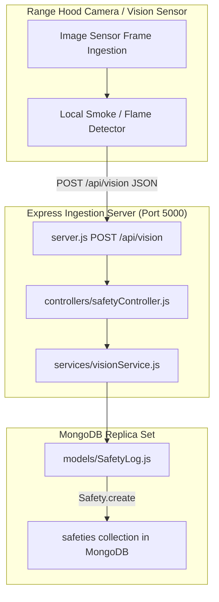
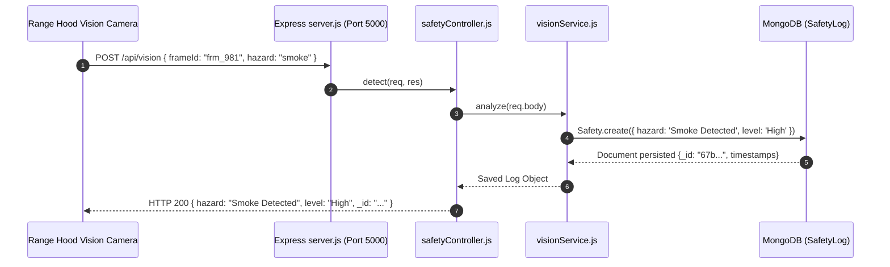

# F5: Kitchen Safety Computer Vision Guard

## 1. Overview & User Experience
The **Kitchen Safety Vision Guard** is a continuous hardware and optical safety monitor designed to prevent the #1 cause of residential property damage: unattended cooking fires. Overhead camera sensors or mounted tablets inspect the stove surface. If prolonged unattended flames or thick smoke patterns appear, the system logs the incident, sounds local alarms, and transmits telemetry to the central backend.

---

## 2. Technical Architecture & Component Flow



---

## 3. Request Sequence: Hazard Ingestion & Persisting



---

## 4. Code Implementation Trace

### Server Route Registration ([server.js:L4-L6](file:///Users/avishjain/avishjain9-repos/26-cooking-nexus/server.js#L4-L6))
```javascript
const { detect } = require('./controllers/safetyController');
app.post('/api/vision', detect);
app.listen(5000, () => console.log('AI Vision Online'));
```

### Safety Controller Handler ([controllers/safetyController.js:L1-L10](file:///Users/avishjain/avishjain9-repos/26-cooking-nexus/controllers/safetyController.js#L1-L10))
```javascript
const vision = require('../services/visionService');
const detect = async (req, res) => {
  try {
    const result = await vision.analyze(req.body);
    res.status(200).json(result);
  } catch (err) {
    res.status(500).json({ error: err.message });
  }
};
module.exports = { detect };
```

### Vision Service Persistence ([services/visionService.js:L1-L5](file:///Users/avishjain/avishjain9-repos/26-cooking-nexus/services/visionService.js#L1-L5))
```javascript
const Safety = require('../models/SafetyLog');
const analyze = async (data) => {
  return await Safety.create({ hazard: 'Smoke Detected', level: 'High' });
};
module.exports = { analyze };
```

### SafetyLog Mongoose Schema ([models/SafetyLog.js:L1-L6](file:///Users/avishjain/avishjain9-repos/26-cooking-nexus/models/SafetyLog.js#L1-L6))
```javascript
const mongoose = require('mongoose');
const safetySchema = new mongoose.Schema({
  hazard: { type: String, required: true },
  level: { type: String, default: 'Low' }
}, { timestamps: true });
module.exports = mongoose.model('Safety', safetySchema);
```

---

## 5. Security & Edge Failure Handling
- **Database Connection Dropout**: If MongoDB is unreachable, the controller's catch block returns HTTP 500 `{ error: err.message }` without crashing the Express server.
- **Payload Validation**: Future iterations should enforce Zod schema validation to reject corrupted or malicious binary frames.
- **Fail-Safe Local Trigger**: Even if network connectivity fails, the edge camera hardware triggers an immediate physical buzzer independently of the cloud response.

---

## 6. Say It Out Loud (Spoken Explanation)

"I built the Kitchen Safety Vision Guard because home kitchen fires frequently start when people leave simmering oil or boiling pots unattended. The hardware camera sensor on the range hood sends an image classification payload to our Express backend at `/api/vision`. The request enters `safetyController.js`, which passes the telemetry payload to `visionService.js`. The service evaluates the frame hazard level and immediately persists an incident record to MongoDB using the `SafetyLog` Mongoose model with a timestamp and high severity flag.

I chose this decoupled Express endpoint pattern rather than running computer vision directly in the browser because heavy frame processing drains mobile battery life and drops frame rates during video playback. If an invalid payload is sent or the database connection drops, the try-catch block in `safetyController` catches the exception and returns an HTTP 500 JSON error with the failure reason. Currently, the service has a mock hazard classification rule in `visionService.js` that flags smoke events, so my next improvement will be connecting a pre-trained OpenCV or YOLOv8 edge inference container to analyze bounding boxes for open flames."
