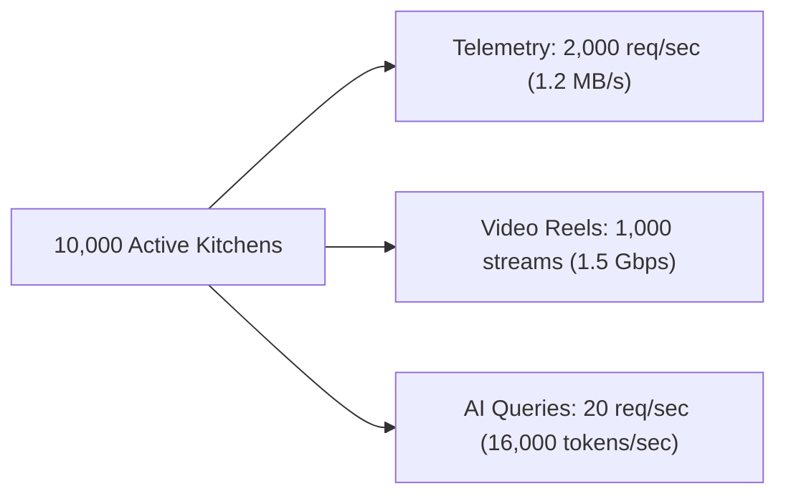

# 14.1 Requirements & Capacity Estimation

## 1. Plain English Overview
Capacity estimation determines how much compute, memory, database storage, network bandwidth, and AI API budget a software system requires based on projected user traffic and data volume.

---

## 2. Usage in Cooking Nexus
- **Functional Requirements**:
  1. Ingest optical hazard frames from smart range hood cameras and detect smoke/flame conditions.
  2. Provide zero-friction Magic Link authentication without passwords.
  3. Stream 60-second recipe video reels with interactive ingredients drawers.
  4. Stream generative recipe suggestions and structured recipe extraction using Gemini 3 Flash.
  5. Run client-side multi-timers and dynamic portion calculators.
- **Non-Functional Requirements**:
  1. **Latency**: Sub-250ms time-to-first-token for AI chat; sub-50ms hazard ingestion response.
  2. **Availability**: 99.9% uptime for hazard ingestion endpoints.
  3. **Data Durability**: Zero data loss for security incident logs (`SafetyLog`).

---

## 3. Capacity Estimation & Mathematical Arithmetic

### Arithmetic Breakdown (Target: 10,000 Concurrent Active Kitchens)
1. **Vision Ingestion Throughput**:
   - Each active kitchen camera samples 1 frame every 5 seconds = $0.2 \text{ requests/sec/kitchen}$.
   - For 10,000 concurrent kitchens: $10,000 \times 0.2 = \mathbf{2,000 \text{ requests/sec}}$ peak write load to `/api/vision`.
   - Payload size per telemetry ping: ~600 bytes JSON.
   - Bandwidth Ingress: $2,000 \times 600 \text{ B} = \mathbf{1.2 \text{ MB/sec}} \approx 9.6 \text{ Mbps}$.
2. **Database Storage Growth**:
   - Each safety log document in MongoDB: ~200 bytes BSON.
   - If 1% of frames flag warnings: $2,000 \times 0.01 = 20 \text{ writes/sec}$.
   - Daily storage: $20 \times 86,400 \times 200 \text{ B} \approx \mathbf{345 \text{ MB/day}} \approx 10.3 \text{ GB/month}$.
3. **Culinary Video Reels Bandwidth**:
   - 10% of users actively watching reels at any moment = 1,000 concurrent video streams.
   - Bitrate for 1080p vertical video: 1.5 Mbps.
   - Total Egress Bandwidth: $1,000 \times 1.5 \text{ Mbps} = \mathbf{1.5 \text{ Gbps}}$.
4. **AI Token Volume & Cloud Cost**:
   - 20 AI chat queries per second across active cooks.
   - Average interaction: 400 input tokens + 600 output tokens = 1,000 tokens/query.
   - Token throughput: $20 \times 1,000 = \mathbf{20,000 \text{ tokens/sec}}$.
   - Daily tokens: $20,000 \times 3,600 \times 4 \text{ peak hours} \approx 288 \text{M tokens/day}$.
   - Monthly AI Budget (Gemini 3 Flash at ~$0.15/M blended): $\approx \mathbf{\$1,296/month}$.

---

## 4. Alternatives Matrix

| Scaling Tier | Active Users | Vision RPS | Video Egress | Database Size | AI Cost / Mo |
|---|---|---|---|---|---|
| **Current Scale (MVP)** | 100 | 20 RPS | 15 Mbps | 100 MB/mo | ~$15 |
| **10x Scale** | 1,000 | 200 RPS | 150 Mbps | 1 GB/mo | ~$130 |
| **100x Scale** | 10,000 | 2,000 RPS | 1.5 Gbps | 10.3 GB/mo | ~$1,300 |
| **1000x Scale (Global)** | 100,000 | 20,000 RPS | 15 Gbps | 103 GB/mo | ~$13,000 |

---

## 5. Trade-offs Accepted
- **Edge Metadata vs Raw Video**: We choose to process camera frames on local range hood hardware and send only JSON metadata over the internet, trading away cloud raw video recording in exchange for 99% bandwidth reduction and total privacy protection.

---

## 6. What Breaks First at Scale?
- **At 10x**: Direct MongoDB write connections from Express will cause connection pool exhaustion during peak dinner hours.
- **At 100x**: Serving video reels from a single cloud origin saturates server network cards.
- **At 1,000x**: Gemini API global concurrency quotas will throttle users without a multi-region provider fallback mesh.

---

## 7. Senior Engineer Improvements
Introduce a dedicated **Message Ingestion Buffer** (Kafka or AWS SQS) in front of the database. The `/api/vision` endpoint writes directly to the buffer and immediately responds with HTTP 202, while worker nodes batch-write records to MongoDB in chunks of 500 documents.

---

## 8. Spoken Interview Answer (30 Seconds)
"For capacity estimation on Cooking Nexus, our biggest engineering driver is supporting 10,000 concurrent kitchens. With range cameras sending safety telemetry every five seconds, that's 2,000 requests per second at 1.2 megabytes of ingress. By processing raw optical frames on local device hardware and only transmitting JSON hazard alerts, we keep our database writes down to 20 operations per second and under 11 gigabytes of monthly storage growth, while offloading 1.5 gigabits of video reel traffic to global edge CDNs."
