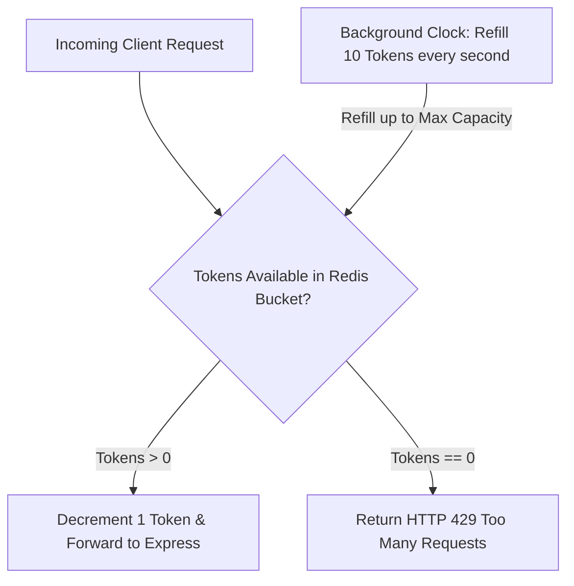

# 14.10 API Design, Rate Limiting & Throttling

## 1. Plain English Overview
API design establishes predictable, secure contracts between clients and servers, while rate limiting protects infrastructure from abusive denial-of-service traffic, brute force password attacks, and runaway cloud API billing.

---

## 2. Usage in Cooking Nexus
- **RESTful Endpoints**: Predictable resource hierarchies ([routes/authRoutes.js](file:///Users/avishjain/avishjain9-repos/26-cooking-nexus/routes/authRoutes.js), [routes/memberRoutes.js](file:///Users/avishjain/avishjain9-repos/26-cooking-nexus/routes/memberRoutes.js)).
- **Edge AI Rate Limiting**: The Lovable AI Gateway enforces HTTP 429 rate limits, intercepted cleanly by [ai-stream.ts:L29-L32](file:///Users/avishjain/avishjain9-repos/26-cooking-nexus/27-kitchen-companion-pro/src/lib/ai-stream.ts#L29-L32).

---

## 3. Rate Limiting Algorithm Flow: Token Bucket

---

## 4. Rate Limiting Algorithms Comparison

| Algorithm | Mechanism | Memory Footprint | Burst Handling | Accuracy | Fit for Cooking Nexus |
|---|---|---|---|---|---|
| **Token Bucket (Recommended)**| Tokens added at constant rate; consumed per request | Low (2 keys: count + timestamp) | Handles short bursts up to capacity | High | Optimal for AI Chat & Vision Ingest |
| **Leaky Bucket** | Requests enter queue and leak at constant rate | Moderate (Queue buffer) | Smooths out traffic, zero bursts | High | Optimal for video transcoding jobs |
| **Fixed Window Counter** | Counts requests in fixed time block (e.g. 1 min)| Ultra-Low (Single integer key) | Vulnerable to 2x burst at window edges| Low | Basic dev testing only |
| **Sliding Window Log** | Stores timestamp of every request in sorted set | Heavy (O(N) memory per client) | Perfect accuracy, no window burst | Ultra-High | Prohibitive memory cost at scale |
| **Sliding Window Counter** | Blends previous and current window counts | Low (Weighted math) | Smooths window boundary spikes | High (~99%) | Excellent for public API routes |

---

## 5. Rate Limit Policies in Production
- **Authentication Route (`POST /api/auth/login`)**: Strict sliding window limit of **5 requests per 15 minutes per IP address** to prevent email spamming.
- **Vision Ingestion Route (`POST /api/vision`)**: Token bucket allowing **2 requests/sec per registered deviceId**, with a burst allowance of 10 tokens.
- **AI Streaming Edge (`POST /functions/v1/chef-ai`)**: **15 requests per minute per authenticated user**, with daily credit quotas.

---

## 6. What Breaks First at Scale?
- **At 10x**: Shared NAT IP blocking: multiple users on a university or office Wi-Fi network sharing a public IP get rate-limited together if limited strictly by IP.
- **At 100x**: Redis rate limiter latency: querying Redis for every incoming optical frame adds 2ms of network overhead if not collocated in the same VPC.
- **At 1,000x**: Distributed clock skew across edge nodes causing inconsistent sliding window calculations.

---

## 7. Senior Engineer Improvements
Implement **Tiered Composite Rate Limiting**:
1. Global Layer 7 WAF (Cloudflare) rate limits abusive IP ranges before reaching the origin.
2. Application rate limiter keys off authenticated `userId` for logged-in cooks and `deviceId` for kitchen hardware, avoiding the shared NAT IP dilemma.

---

## 8. Spoken Interview Answer (30 Seconds)
"To protect Cooking Nexus from denial-of-service surges and runaway LLM billing, we implement a Token Bucket rate limiter in Redis. This allows home cooks to execute rapid bursts of conversation while capping sustained traffic to 15 queries per minute. For hardware telemetry, we key rate limits off the authenticated hardware `deviceId` rather than the public IP, ensuring that multiple smart appliances operating in the same house never throttle each other."
