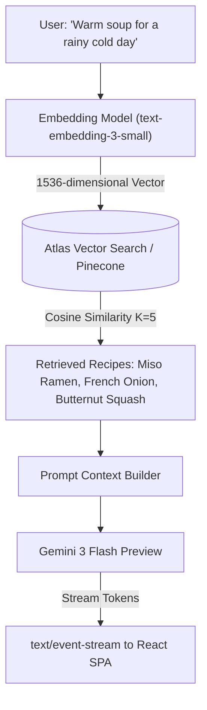

# 14.12 Search & AI Integration Architecture

## 1. Plain English Overview
Search and AI architecture manages how users discover content (lexical text indexing vs semantic vector similarity) and how generative AI models are prompted, streamed, cached, and guarded to deliver accurate answers with minimal cost and latency.

---

## 2. Usage in Cooking Nexus
- **AI Streaming Gateway**: Google's Gemini 3 Flash model via Lovable AI Gateway with Server-Sent Events ([chef-ai/index.ts](file:///Users/avishjain/avishjain9-repos/26-cooking-nexus/27-kitchen-companion-pro/supabase/functions/chef-ai/index.ts), [ai-stream.ts](file:///Users/avishjain/avishjain9-repos/26-cooking-nexus/27-kitchen-companion-pro/src/lib/ai-stream.ts)).
- **Prompt Personas**: Conversational Chef (`chat`), Theatrical Comparative Gastronomy (`ghostchef`), Structured JSON Extraction (`import`).
- **Global Search**: [src/pages/GlobalSearchPage.tsx](file:///Users/avishjain/avishjain9-repos/26-cooking-nexus/27-kitchen-companion-pro/src/pages/GlobalSearchPage.tsx) indexing dishes, chefs, tags, and preparation times.

---

## 3. Semantic Vector Search & AI Pipeline Architecture

---

## 4. Search Architecture Comparison

| Search Engine | Mechanism | Query Type | Latency | Infrastructure Overhead | Fit for Cooking Nexus |
|---|---|---|---|---|---|
| **MongoDB Text Index** | Inverted Index (BM25) | Exact word matches, stemming | Low (Local DB index) | Zero extra infrastructure | Ideal for MVP recipe titles |
| **Atlas Vector Search (Target)**| HNSW Vector Embeddings | Semantic meaning & intent | Moderate (~25ms) | Integrated in MongoDB | Optimal for semantic recipe discovery |
| **Elasticsearch / OpenSearch** | Distributed Lucene Cluster | Full-text, fuzzy, aggregations | Low-Moderate | High (Dedicated JVM cluster) | Overkill for early stage |
| **Algolia / Meilisearch** | Hosted Instant Search API | Typo-tolerant prefix search | Ultra-Low (<10ms) | Managed Cloud API | Great, but high SaaS cost at scale |
| **Pinecone** | Dedicated Vector SaaS | High-dimensional k-NN | Low | Managed SaaS API | Good alternative to Atlas Vector |

---

## 5. Structured Output & Hallucination Mitigation
1. **JSON Schema Injection**: In `import` mode, the prompt enforces a rigid JSON schema specifying mandatory integer fields for `prep_time` and `servings`.
2. **Grounding via Retrieval-Augmented Generation (RAG)**: Rather than asking the LLM to invent an obscure Thai curry recipe from memory, the system retrieves verified culinary ingredient ratios from the database and injects them as grounding context.

---

## 6. What Breaks First at Scale?
- **At 10x**: LLM cost spikes during viral user influxes if common queries ("substitute butter") are not cached.
- **At 100x**: Vector embedding API rate limits when generating embeddings for thousands of newly uploaded creator recipes.
- **At 1,000x**: Context window memory bloat if full recipe histories are fed into chat context without conversational summarization.

---

## 7. Senior Engineer Improvements
Implement a **Semantic Redis Cache with Cosine Similarity**:
Before calling Gemini 3 Flash, compute the vector embedding of the user's question and query Redis with `FT.SEARCH`. If a prior query has a cosine similarity $> 0.96$, return the cached response immediately, slashing LLM API costs by up to 70%.

---

## 8. Spoken Interview Answer (30 Seconds)
"Our AI architecture combines Server-Sent Events streaming with prompt persona routing. To deliver sub-second culinary intelligence without hallucinations, we use Gemini 3 Flash for zero-shot recipe parsing and conversational substitutions, with strict system prompt guardrails. As our recipe catalogue scales, we plan to implement a RAG pipeline using Atlas Vector Search to retrieve verified ingredient ratios, ensuring our generative sous chef always grounds its answers in culinary facts."
