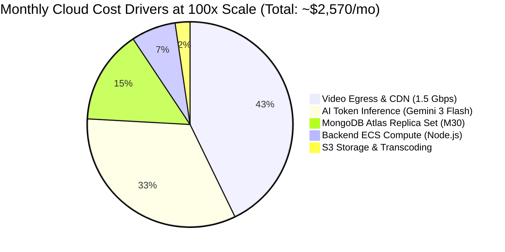

# 14.16 Cloud Economics, Infrastructure Costs & Trade-Offs

## 1. Plain English Overview
Cloud economics evaluates the financial cost of running a software architecture at scale, balancing managed cloud services against raw infrastructure, and identifying the primary cost drivers (compute, database, AI tokens, network bandwidth, storage egress).

---

## 2. Usage in Cooking Nexus
- **Pre-Trained AI via Gateway**: Eliminates dedicated GPU server costs (~$1,050/mo base) by paying only for generated tokens (~$0.075 / 1M input tokens).
- **Static Frontend on CDN**: Hosted on zero-cost or low-cost edge CDNs (Vercel / Cloudflare).
- **Decoupled Backend**: Ingestion and database scale independently on standard x86 CPU containers.

---

## 3. Monthly Cost Projection: Current vs 100x Scale

### Detailed Cost Breakdown Table

| Infrastructure Component | Current Scale (MVP: 100 Daily Kitchens) | 100x Scale (Production: 10,000 Active Kitchens) | Primary Cost Driver |
|---|---|---|---|
| **Frontend Static Hosting** | $0 (Vercel Hobby / Cloudflare Pages) | $20/mo (Cloudflare Pro / Custom Domain) | Edge request volume |
| **Backend Compute (Express)** | $7/mo (Render / Railway starter) | $180/mo (4x AWS ECS Fargate containers) | CPU & RAM for telemetry parsing |
| **MongoDB Database** | $0 (MongoDB Atlas Shared M0) | $380/mo (MongoDB Atlas Dedicated M30 Replica Set)| RAM cache, IOPS, multi-AZ storage |
| **Video Reel CDN Egress** | $5/mo (Low bandwidth) | $1,100/mo (Cloudflare R2 + CloudFront egress) | Video streaming bandwidth (1.5 Gbps) |
| **AI Tokens (Gemini 3 Flash)**| $15/mo (~100k queries) | $850/mo (~10M queries with semantic caching) | Generative AI chat & recipe parsing |
| **Object Storage (S3 / R2)**| $2/mo (10 GB storage) | $40/mo (1 TB video & photo storage) | Gigabytes stored |
| **Total Monthly Running Cost**| **~$29 / month** | **~$2,570 / month** | **Bandwidth & AI Tokens** |

---

## 4. Build vs Buy Analysis

| Capability | Decision | Rationale | Cost Impact |
|---|---|---|---|
| **AI Inference** | **Buy (API)** | Training a custom model costs $20k+ with no guarantee of beating Gemini 3 Flash. | Saved ~$20,000 in upfront ML engineering |
| **Authentication** | **Build (JWT Magic)** | Building lightweight 15m JWT magic links eliminated Auth0/Clerk monthly active user charges ($0.05/MAU = $500/mo at 10k users). | Saved ~$6,000/year |
| **Video Player** | **Build (HTML5)** | Headless React component with Tailwind CSS avoided heavy $400/mo enterprise video player licensing. | Saved ~$4,800/year |
| **Database** | **Buy (Atlas Managed)**| Managing raw MongoDB on EC2 requires dedicated DBA staff for backups, failover, and OS patching. | Worth the $380/mo managed fee |

---

## 5. Vendor Lock-In & Exit Strategy
- **Risk**: Reliance on Lovable Gateway / Google Gemini 3 Flash.
- **Exit Strategy**: Our edge function uses the standard OpenAI-compatible `/chat/completions` API interface. If Google increases pricing or the gateway suffers an outage, switching to OpenAI GPT-4o mini, Mistral, or Groq Llama 3 requires changing only two environment variables (`API_KEY` and `ENDPOINT_URL`) with zero code alterations.

---

## 6. What Breaks First at Scale?
- Video streaming egress bills can skyrocket unpredictably if users leave reels playing in background tabs.
- **Defense**: Enforce a 5-minute inactivity auto-pause on video feeds.

---

## 7. Spoken Interview Answer (30 Seconds)
"At 10,000 active kitchens, our projected operational cloud cost is approximately $2,570 a month, with video egress and AI tokens representing over 75% of the total spend. We kept our burn rate ultra-lean by making smart build-versus-buy decisions: we built our own passwordless JWT auth to avoid expensive per-MAU SaaS fees, while leveraging Google's Gemini 3 Flash via API rather than burning tens of thousands of dollars training a custom ML model."
