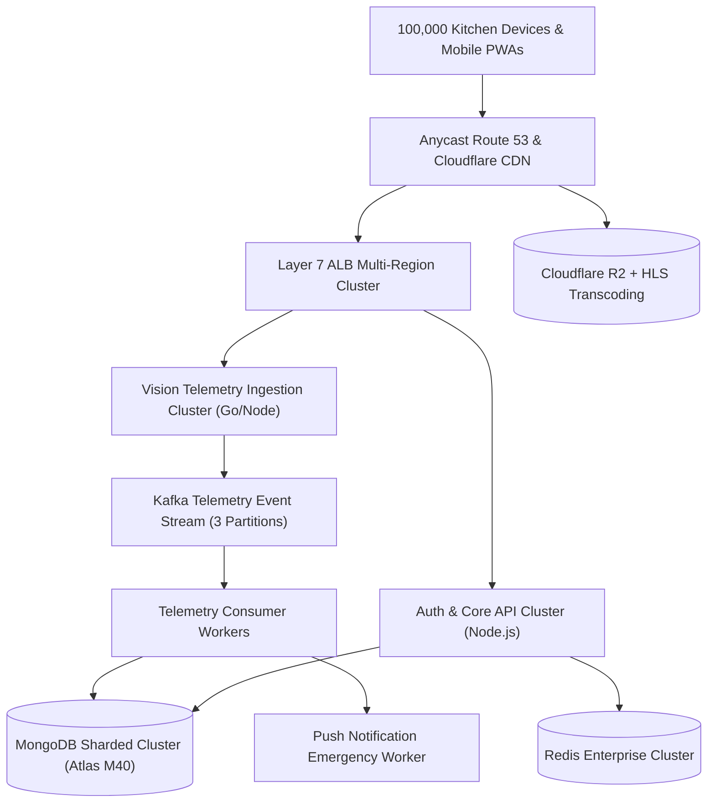
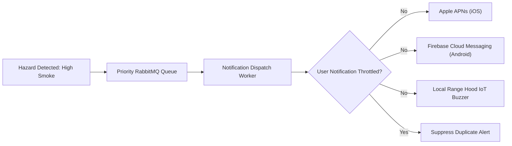
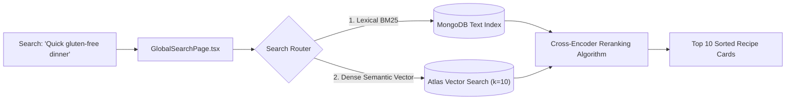
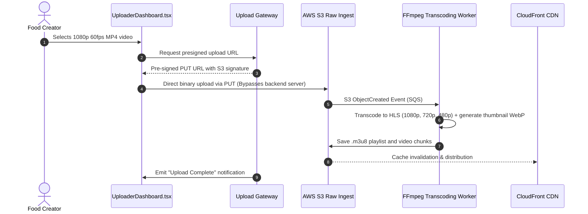
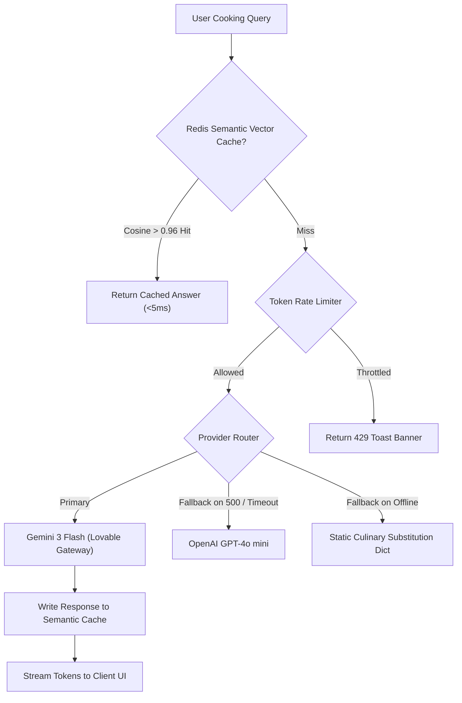

# 14.17 Classic System Design Problems Applied to Cooking Nexus

This document provides complete, interview-grade architectural breakdowns for classic system design interview problems, mapped directly to the Cooking Nexus technical stack and domain.

---

## 1. Design Cooking Nexus at 100x Scale (100,000 Kitchens)

- **Requirements**: Ingest 20,000 requests/sec of optical hazard frames with sub-50ms acknowledgment; serve 10,000 concurrent video reel streams.
- **Deep Dive**:
  - The single Express monolith is decomposed: `/api/vision` is extracted into a stateless Go microservice that writes directly to Apache Kafka partitions hashed by `deviceId`.
  - Workers consume Kafka events in micro-batches and bulk-insert them into a sharded MongoDB cluster.
  - Video reels are transcoded to HLS and cached across Cloudflare edge nodes, reducing origin egress by 98%.

---

## 2. Design the Kitchen Safety Notification System

- **Requirements**: Sub-1 second push alert delivery to the homeowner's smartphone when the stove is left unattended with active smoke.
- **Deep Dive**:
  - Employs a **Priority Message Queue** where critical fire alerts bypass routine social reel comments.
  - Workers query Redis to verify the user has not received an alert within the last 30 seconds (alert de-duplication), then dispatch parallel pushes via APNs and FCM HTTP/2 connections.

---

## 3. Design the Culinary Global Search Engine

- **Requirements**: Search across 100,000 recipes by dish name, ingredient keyword, cuisine, and abstract natural language queries ("something warm for a cold day").
- **Deep Dive**:
  - Implements **Hybrid Search**: combines keyword BM25 scoring with dense vector cosine similarity (via `text-embedding-3-small`).
  - A Reciprocal Rank Fusion (RRF) algorithm blends lexical and semantic score arrays to rank the best recipes at the top.

---

## 4. Design the Reel Video Upload & Media Transcoding System

- **Requirements**: Handle 500MB raw video uploads without crashing the Node.js backend; generate multi-bitrate HLS streams and video poster thumbnails.
- **Deep Dive**:
  - Uses **S3 Pre-Signed URLs**: the client uploads directly to object storage, meaning heavy video bytes never touch our Express application server RAM.
  - EventBridge triggers an asynchronous containerized FFmpeg worker that slices video into 2-second `.ts` segments and builds the `.m3u8` master manifest.

---

## 5. Design an AI Request Pipeline with Queueing, Caching & Fallbacks

- **Requirements**: Provide 99.99% availability for conversational recipe advice; maintain sub-250ms latency; handle provider outages gracefully.
- **Deep Dive**:
  - Queries a semantic vector cache in Redis before dispatching external calls.
  - Utilizes a circuit breaker that trips to secondary providers (GPT-4o mini or Groq) if the primary gateway fails for $> 3$ consecutive requests.

---

## 6. Classic Reused Stack Building Blocks

### A. URL Shortener (e.g. `cook.io/r/9x1A`)
- **Building Block**: Express routing + MongoDB / Redis.
- **Implementation**: The short code `9x1A` is converted from base62 into an integer ID, querying Redis key `url:9x1A` with a 301 Permanent Redirect to the full recipe reel URL.

### B. Ephemeral Chat System (Social Cooking Threads)
- **Building Block**: WebSockets + MongoDB TTL Index.
- **Implementation**: Real-time comments delivered via Socket.io. Messages are stored in a MongoDB collection with `{ expireAfterSeconds: 86400 }` to auto-purge chats after 24 hours.

### C. Activity News Feed (Fanout-on-Write)
- **Building Block**: Redis Sorted Sets (`ZADD`).
- **Implementation**: When a chef posts a new recipe, a background worker pushes the recipe ID into the timeline Redis sorted sets of all their followers with the timestamp as the score: `ZADD timeline:user_123 1740484800 recipe_991`.
