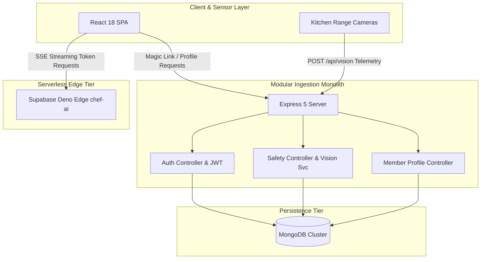

# 14.2 Architecture Styles: Monolith vs Modular vs Serverless

## 1. Plain English Overview
An architectural style defines how system components are partitioned, deployed, and communicate with each other—ranging from a single unified codebase (monolith) to decoupled independent network services (microservices) or ephemeral cloud functions (serverless).

---

## 2. Usage in Cooking Nexus
Cooking Nexus uses a **Hybrid Modular Monolith + Serverless Edge Architecture**:
- **Core Ingestion & Auth**: Structured as a modular Express monolith ([server.js](file:///Users/avishjain/avishjain9-repos/26-cooking-nexus/server.js)) with distinct controllers, services, and Mongoose models.
- **AI Inference**: Delegated to serverless edge functions ([supabase/functions/chef-ai/index.ts](file:///Users/avishjain/avishjain9-repos/26-cooking-nexus/27-kitchen-companion-pro/supabase/functions/chef-ai/index.ts)) to stream Gemini 3 Flash tokens without tying up Express threads.
- **Frontend SPA**: React 18 single-page application served statically via CDN.

---

## 3. Architecture Topology Diagram

---

## 4. Architectural Alternatives Comparison

| Architectural Style | Development Velocity | Operational Complexity | Network Latency | Fault Isolation | Fit for Cooking Nexus |
|---|---|---|---|---|---|
| **Hybrid Modular (Chosen)** | High (Single repo, shared types) | Low (Single deployment target)| Zero IPC overhead | Moderate (Edge separates AI) | Optimal for current scale |
| **Pure Microservices** | Low (Heavy boilerplate) | Extreme (K8s, service mesh) | High (Inter-service RPC hops) | High (Isolated blast radius) | Overkill for early stage |
| **Pure Serverless (Lambda)** | Moderate (Cold start delays) | Moderate (Vendor IAM rules) | Unpredictable cold starts | High per function | Bad for continuous vision sockets |
| **Hexagonal / Clean Arch** | Slow (Extreme abstraction) | High (Interfaces, ports/adapters)| Minimal | High | Excessive ceremony for CRUD |

---

## 5. Trade-offs Accepted
- **Monolith Shared Process**: If an uncaught exception crashes the Express process, both auth and vision ingestion go down simultaneously. This was accepted because Node process managers (`pm2` or Docker restart policies) reboot the process in <1 second.

---

## 6. What Breaks First at Scale?
- **At 10x**: Shared memory saturation if image frames are buffered in RAM inside the Node process.
- **At 100x**: Deployment lock-in: updating the member profile route requires redeploying the vision ingestion server.
- **At 1,000x**: Inter-module database contention: heavy vision writes compete with member authentication reads on the same MongoDB instance.

---

## 7. Senior Engineer Decomposition Plan
When monthly active kitchens exceed 50,000, carve out the `/api/vision` ingestion pipeline into a standalone Go microservice using gRPC, leaving Express to manage user accounts and social feeds.

---

## 8. Spoken Interview Answer (30 Seconds)
"We chose a hybrid architecture: a modular Express monolith for core authentication and vision ingestion, paired with serverless Deno edge functions for streaming AI tokens. This gives us the high developer velocity and zero-IPC simplicity of a monolith, while completely isolating heavy, long-lived LLM streaming connections from our core safety telemetry server. We avoid the operational tax of microservices until scaling demands independent service autoscaling."
