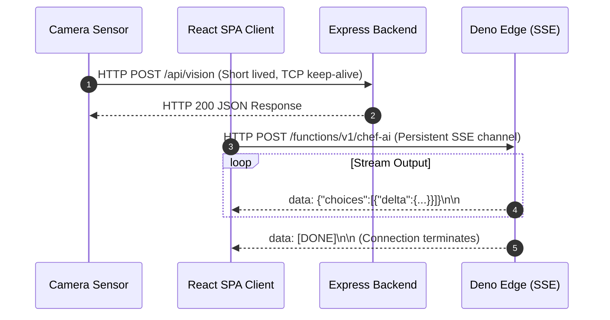

# 14.3 Networking & Communication Protocols

## 1. Plain English Overview
Networking governs how data travels between client devices, smart sensors, cloud servers, and third-party APIs—covering transport protocols (TCP/UDP, HTTP/1.1 vs HTTP/2 vs HTTP/3) and communication patterns (REST, GraphQL, WebSockets, Server-Sent Events).

---

## 2. Usage in Cooking Nexus
- **REST over HTTP/1.1 & HTTP/2**: Used for CRUD operations (`/api/auth/login`, `/api/vision`, `/api/members/:id`).
- **Server-Sent Events (SSE)**: Used in [ai-stream.ts](file:///Users/avishjain/avishjain9-repos/26-cooking-nexus/27-kitchen-companion-pro/src/lib/ai-stream.ts) and [chef-ai/index.ts](file:///Users/avishjain/avishjain9-repos/26-cooking-nexus/27-kitchen-companion-pro/supabase/functions/chef-ai/index.ts) (`text/event-stream`) to stream AI recipe tokens.
- **TLS 1.3**: Secures all data in transit across public networks.

---

## 3. Communication Protocol Flow

---

## 4. Protocol Comparison Matrix

| Protocol | Transport | Directionality | Connection Overhead | Firewall Friendly | Fit for Cooking Nexus |
|---|---|---|---|---|---|
| **REST (HTTP/1.1 / H2)**| TCP | Request-Response | Low (reused sockets) | 100% | Primary CRUD & Telemetry |
| **Server-Sent Events** | TCP | Server to Client | Low (single HTTP stream)| 100% | Optimal for AI Chat Streaming |
| **WebSockets** | TCP | Full-Duplex Bi-directional | High (Stateful sticky proxy)| 90% (Some firewalls block) | Future live cooking streams |
| **gRPC / Protobuf** | HTTP/2 | Bi-directional Binary | Ultra-Low (Binary framing) | Internal VPC only | Future inter-service RPC |
| **GraphQL** | HTTP | Client-defined queries | Moderate (Parsing tax) | 100% | Unnecessary complexity for our schema |
| **MQTT** | TCP | Lightweight Pub/Sub | Ultra-Low (IoT micro-packets) | Requires MQTT broker | Future smart oven/scale bridge |

---

## 5. Trade-offs Accepted
- **SSE vs WebSockets**: We chose SSE for AI streaming instead of WebSockets. SSE is strictly unidirectional, meaning the client cannot send additional voice feedback over the same open stream; however, it eliminates the operational headache of maintaining stateful WebSocket gateway clusters.

---

## 6. What Breaks First at Scale?
- **At 10x**: TCP socket starvation on the Express server if IoT sensors open new connections instead of reusing HTTP keep-alive connections.
- **At 100x**: Client connection limits: HTTP/1.1 browser connection limits (max 6 sockets per domain) block multiple parallel AI streams unless upgraded to HTTP/2.
- **At 1,000x**: Global latency degradation for European and Asian cooks hitting a single US-East origin.

---

## 7. Senior Engineer Improvements
Deploy Cloudflare or AWS CloudFront with **HTTP/3 (QUIC)** enabled at the edge. HTTP/3 eliminates TCP head-of-line blocking, allowing cooks on lossy kitchen Wi-Fi to stream video reels and AI tokens without connection stalls.

---

## 8. Spoken Interview Answer (30 Seconds)
"In Cooking Nexus, we strategically match protocols to communication patterns: standard REST over HTTP/2 for short-lived telemetry ingestion and authentication, and Server-Sent Events for streaming generative AI responses. We deliberately chose SSE over WebSockets for AI chat because it operates over standard HTTP, traverses firewalls seamlessly, and avoids stateful WebSocket connection cluster overhead while delivering real-time token streaming."
