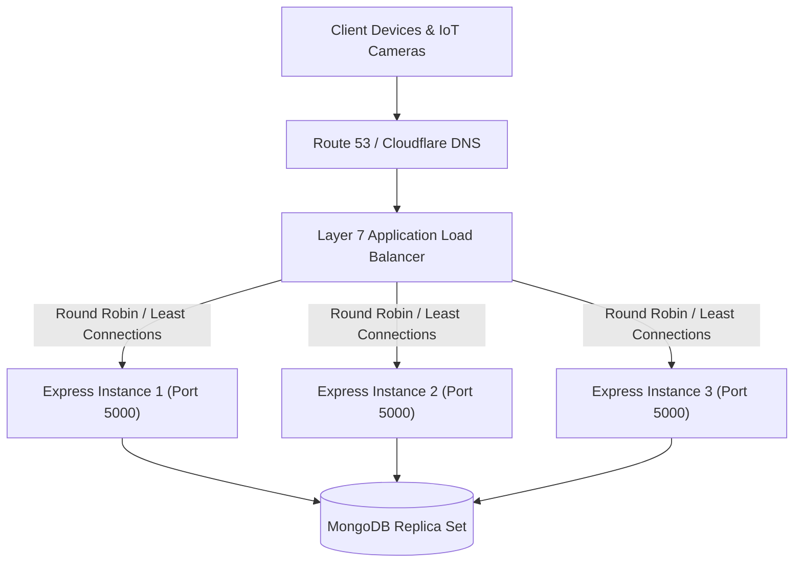

# 14.4 Load Balancing & Horizontal Scaling

## 1. Plain English Overview
Load balancing distributes incoming client requests across a pool of backend servers to ensure no single server becomes overwhelmed, enabling horizontal scaling (adding more instances) and high availability.

---

## 2. Usage in Cooking Nexus
- The Express backend is designed as a **Stateless Application**. User authentication state is encapsulated entirely within signed JSON Web Tokens ([controllers/authController.js](file:///Users/avishjain/avishjain9-repos/26-cooking-nexus/controllers/authController.js)), meaning any server instance can handle any incoming request without requiring sticky sessions.
- In production, a Layer 7 Application Load Balancer (ALB) terminates TLS and routes traffic across backend Docker containers.

---

## 3. Load Balancing Topology

---

## 4. Load Balancing Algorithms Comparison

| Algorithm | Mechanism | Pros | Cons | Fit for Cooking Nexus |
|---|---|---|---|---|
| **Round Robin (Chosen default)**| Cycles sequentially through server list | Simple, zero overhead | Ignores server CPU load | Excellent for stateless pings |
| **Least Connections (Recommended)**| Routes to server with fewest open TCP sockets | Prevents overload on heavy tasks | Requires central state tracking| Best for mixed telemetry/heavy routes |
| **IP Hash (Sticky)** | Hashes client IP to select server | Retains local in-memory caches | Uneven load distribution | Anti-pattern for stateless APIs |
| **Layer 4 (Transport/TCP)** | Routes based on IP and port only | Ultra-fast (microsecond latency)| Cannot inspect HTTP paths or headers| Good for raw MQTT, bad for REST |
| **Layer 7 (Application/HTTP)** | Inspects URL, headers, and cookies | Intelligent path-based routing | Slight CPU parsing overhead | Optimal for routing `/api/*` vs `/cdn/*` |

---

## 5. Trade-offs Accepted
- **Stateless vs Local Caching**: Keeping backend nodes completely stateless means we cannot cache user profiles in local Node.js process memory without risk of stale cache across instances, requiring a central Redis cache.

---

## 6. What Breaks First at Scale?
- **At 10x**: ALB health checks fail if a single long-running query blocks the Node.js event loop on one instance.
- **At 100x**: Database connection exhaustion: 50 horizontally scaled Express instances opening 20 Mongoose connections each = 1,000 open connections to MongoDB, reaching Atlas connection caps.
- **At 1,000x**: Single cloud region ALB failure: an AWS us-east-1 outage takes down all backend instances simultaneously.

---

## 7. Senior Engineer Improvements
1. Implement a dedicated `/health` endpoint that checks database ping without executing heavy queries.
2. Introduce a **Connection Pooling Proxy** (like AWS DocumentDB elastic clusters or MongoDB connection pooling sidecars) to multiplex database connections.
3. Configure **Multi-Region Active-Active Failover** with Route 53 latency routing.

---

## 8. Spoken Interview Answer (30 Seconds)
"Because our Express backend is completely stateless and uses self-contained JWT tokens for authentication, we can scale horizontally behind a Layer 7 Application Load Balancer using a Least Connections algorithm. Any instance can process an incoming `/api/vision` frame or verify a magic login token without requiring sticky sessions. As we scale out instances, we guard our database connection limit using connection pool caps in Mongoose to prevent replica set saturation."
