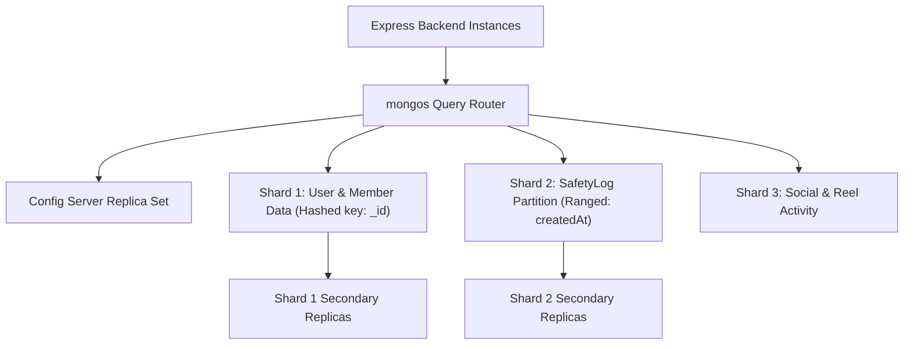

# 14.5 Databases & Storage: SQL, NoSQL & Polyglot Persistence

## 1. Plain English Overview
Databases store, query, and preserve application data, balancing structural guarantees (ACID transactions), query flexibility (document vs relational), horizontal scalability, and latency.

---

## 2. Usage in Cooking Nexus
- **Primary Operational Store**: MongoDB with Mongoose ODM `^8.23.0` ([models/User.js](file:///Users/avishjain/avishjain9-repos/26-cooking-nexus/models/User.js), [models/SafetyLog.js](file:///Users/avishjain/avishjain9-repos/26-cooking-nexus/models/SafetyLog.js), [models/Member.js](file:///Users/avishjain/avishjain9-repos/26-cooking-nexus/models/Member.js)).
- **Object Storage (Media)**: S3-compatible cloud object store for 1080p culinary reel video MP4s and recipe photography.
- **Client Cache**: Browser `localStorage` for offline session and theme preferences.

---

## 3. Database Cluster & Sharding Architecture



---

## 4. Comprehensive Storage Paradigm Comparison

| Storage Category | Technology | Data Structure | ACID Guarantee | Scalability | Fit for Cooking Nexus |
|---|---|---|---|---|---|
| **Document NoSQL (Chosen)**| MongoDB / Mongoose | BSON Documents | Document-level ACID | Native Horizontal Sharding | Optimal for polymorphic recipes & logs |
| **Relational (RDBMS)**| PostgreSQL / MySQL | Strict Tables & Rows | Strict Multi-Table ACID | Vertical / Citus Sharding | Best for future creator royalty ledgers |
| **Key-Value Cache** | Redis / Memcached | In-Memory Strings/Hashes| Atomic operations | Redis Cluster | Essential for sub-millisecond session cache |
| **Time-Series Engine** | InfluxDB / TimescaleDB| Timestamped Metrics | Eventual | High-throughput Partitioning| Ideal for IoT sensor temperature curves |
| **Vector Database** | Pinecone / pgvector | Float32 Embedding Arrays| Eventual | Horizontal Index Sharding | Ideal for semantic recipe similarity search |
| **Blob / Object Store** | AWS S3 / Cloudflare R2 | Binary Blobs (MP4, WebP)| Read-after-write | Unlimited Cloud Scale | Mandatory for recipe videos & photos |

---

## 5. CAP & PACELC Theorem Position
- **CAP Theorem**: MongoDB is traditionally a **CP System** (Consistency & Partition Tolerance). In a network partition, the majority partition elects a primary while the minority rejects writes, guaranteeing consistent reads and preventing split-brain safety logs.
- **PACELC Theorem**: In Normal operation (Else), MongoDB trades off strict write latency for tunable consistency (`w: "majority", j: true` vs `w: 1`).

---

## 6. What Breaks First at Scale?
- **At 10x**: Unindexed queries on `Member.preferences` or `SafetyLog.hazard` trigger full collection scans, spiking CPU to 100%.
- **At 100x**: Single MongoDB primary disk I/O saturates from continuous append-only safety log writes.
- **At 1,000x**: Shard key hotspotting: if `SafetyLog` is sharded by timestamp, all write traffic hammers a single active shard.

---

## 7. Senior Engineer Improvements
1. **Sharding Strategy**: Shard the `SafetyLog` collection using a **Compound Hashed Shard Key** (`{ deviceId: "hashed", createdAt: 1 }`), distributing write traffic evenly across all cluster shards.
2. **TTL Index for Ephemeral Logs**: Add a TTL index to auto-delete low-severity safety logs older than 90 days:
   ```javascript
   safetySchema.index({ createdAt: 1 }, { expireAfterSeconds: 7776000 });
   ```
3. **Polyglot Evolution**: Retain MongoDB for recipes and telemetry, but introduce **PostgreSQL** for creator earnings and payouts.

---

## 8. Spoken Interview Answer (30 Seconds)
"We chose MongoDB because culinary recipes and kitchen sensor events are inherently unstructured documents. A recipe has variable ingredient lists and prep steps, while safety logs are append-heavy telemetry entries. MongoDB gives us document-level ACID guarantees, native horizontal sharding, and effortless JSON mapping to our Node backend. If our creator monetization logic grows to require complex multi-table financial ledgers, I would transition financial balances to PostgreSQL in a polyglot architecture."
