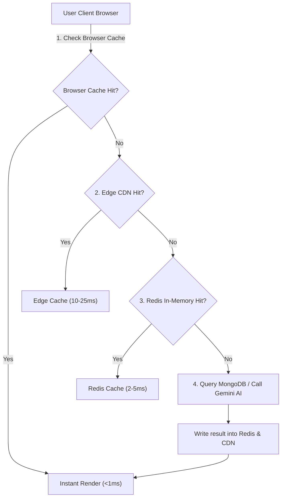

# 14.6 Caching Strategies & Cache Invalidation

## 1. Plain English Overview
Caching stores copies of frequently accessed data in high-speed storage (such as in-memory RAM) so subsequent requests are served in microseconds rather than querying slower disk-bound databases or expensive AI APIs.

---

## 2. Usage in Cooking Nexus
- **Browser & CDN Cache**: Static JS/CSS chunks and recipe images cached via HTTP `Cache-Control: public, max-age=31536000, immutable`.
- **Client Application Cache**: TanStack React Query maintains an in-memory query cache in [27-kitchen-companion-pro/src/App.tsx:L42](file:///Users/avishjain/avishjain9-repos/26-cooking-nexus/27-kitchen-companion-pro/src/App.tsx#L42) (`new QueryClient()`), caching recipe lists and user preferences.
- **Planned In-Memory Cache**: Redis caching layer for member profiles and common AI substitution queries.

---

## 3. Multi-Layer Caching Flow

---

## 4. Caching Patterns Comparison

| Strategy | Read Flow | Write Flow | Consistency | Latency | Fit for Cooking Nexus |
|---|---|---|---|---|---|
| **Cache-Aside (Recommended)**| Read cache; on miss read DB & write cache | Write directly to DB; invalidate cache | Eventual consistency | Low | Optimal for recipe views & member profiles |
| **Read-Through** | Client only reads cache; cache auto-loads DB | Same as above | Stronger | Low | Requires cache provider plugin |
| **Write-Through** | Client writes to cache; cache writes to DB | Synchronous dual write | Strong consistency | Higher write latency | Good for critical financial ledgers |
| **Write-Back (Write-Behind)**| Client writes to cache; cache writes DB async| Batched async DB writes | Risk of data loss on crash | Ultra-low write latency | Good for high-frequency kitchen scale logs |
| **Write-Around** | Client writes direct to DB bypassing cache | Does not touch cache on write | Prevents cache pollution | Higher read latency on first load | Good for raw safety logs |

---

## 5. Cache Eviction & Invalidation Policies
1. **Eviction Policy**: **LRU (Least Recently Used)** in Redis ensures that recipes viewed weeks ago are naturally evicted to make room for trending viral reels.
2. **TTL (Time to Live)**:
   - User Profiles: 15-minute TTL. Invalidate immediately on profile edit (`updateProfile()`).
   - AI Substitution Cache: 7-day TTL (culinary science substitutions rarely change).
3. **Thundering Herd / Cache Stampede Defense**: When a cached viral recipe expires, use **Mutex Locking** (`SET recipe:butter-chicken:lock true EX 5 NX`) so only one request queries MongoDB while other concurrent requests wait or serve stale data.

---

## 6. What Breaks First at Scale?
- **At 10x**: Stale profile data if a user updates their dark mode preference but the client serves the cached profile.
- **At 100x**: Redis memory exhaustion if large video reel manifests are stored without compression.
- **At 1,000x**: Cache stampede: hundreds of thousands of concurrent users browsing a viral Christmas turkey recipe when its cache key expires, crashing the primary MongoDB replica.

---

## 7. Senior Engineer Improvements
Implement **Probabilistic Early Expiration (XFetch algorithm)** in Redis: recompute and refresh the cache key in the background slightly before the TTL expires based on request frequency, ensuring zero cache stampede spikes.

---

## 8. Spoken Interview Answer (30 Seconds)
"In Cooking Nexus, we use a multi-tier caching hierarchy: HTTP edge caching for static recipe media, TanStack Query for client-side state, and a Cache-Aside Redis layer for member profiles and common AI substitution prompts. To protect our primary database from cache stampedes when viral cooking reels expire, we combine a 15-minute TTL with mutex locking, ensuring only one worker queries MongoDB while other concurrent requests receive stale-while-revalidate data."
