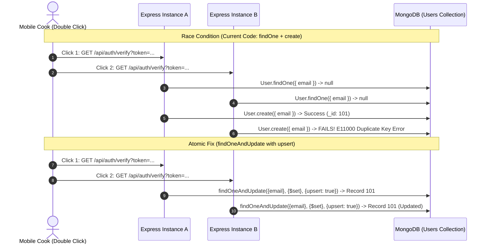

# 14.8 Consistency, Concurrency & Distributed Systems

## 1. Plain English Overview
Consistency defines how quickly data updates become visible across all nodes in a distributed system, while concurrency controls ensure that multiple simultaneous user or device actions (such as two people liking a recipe or updating inventory) do not cause data corruption or race conditions.

---

## 2. Usage in Cooking Nexus
- **Eventual Consistency**: Reel like counters and social comment counts use eventual consistency to maximize write throughput.
- **Strong Read-Your-Writes Consistency**: User profile and preference updates ([models/Member.js](file:///Users/avishjain/avishjain9-repos/26-cooking-nexus/models/Member.js)) require immediate consistency on the primary database node.
- **Concurrency Risk in Code**: Non-atomic user creation in [controllers/authController.js:L22-L23](file:///Users/avishjain/avishjain9-repos/26-cooking-nexus/controllers/authController.js#L22-L23).

---

## 3. Concurrency Race Condition & Atomic Resolution



---

## 4. Consistency Models Comparison

| Consistency Model | Latency | Write Availability | Data Stale Window | Fit for Cooking Nexus Domain |
|---|---|---|---|---|
| **Strong Consistency** | High | Reduced during partitions | Zero (Reads always latest) | Mandatory for Auth & Billing |
| **Eventual Consistency** | Low | High across all partitions| Milliseconds to seconds | Optimal for Reel Likes & Views |
| **Causal Consistency** | Moderate | High | Follows causality chain | Good for Comment Threads |
| **Read-Your-Writes** | Low-Moderate | Available on primary node | Zero for author, eventual for others| Optimal for Profile & Meal Planner Edits |

---

## 5. Distributed Locking (Redlock)
When two chefs simultaneously attempt to reserve the last ticket for a live culinary masterclass or execute an exclusive creator sponsorship:
- Standard database transactions can cause lock contention across shards.
- **Redlock Solution**: Acquire an in-memory distributed lock in Redis with an auto-expiring lease:
  ```javascript
  const lock = await redlock.acquire(['locks:masterclass:991'], 5000);
  try {
    // Execute seat reservation logic
  } finally {
    await lock.release();
  }
  ```

---

## 6. What Breaks First at Scale?
- **At 10x**: Duplicate key errors from double-click verification requests in `authController.js`.
- **At 100x**: Replica read lag: users update their display name, but immediate page navigation queries a secondary replica with 200ms replication lag, showing their old name.
- **At 1,000x**: Distributed deadlock if two services acquire locks in reverse order across services.

---

## 7. Senior Engineer Improvements
1. Replace non-atomic lookups in `authController` with **Atomic Upsert** operations.
2. Direct all post-mutation reads to the **MongoDB Primary** using Mongoose read preference:
   ```javascript
   Member.findById(id).read('primary');
   ```

---

## 8. Spoken Interview Answer (30 Seconds)
"In Cooking Nexus, we balance consistency requirements by domain: we enforce strong read-your-writes consistency on primary nodes for authentication and profile updates, while accepting eventual consistency for social metrics like reel view counters. To eliminate concurrency race conditions on user signups, we avoid separate `findOne` and `create` calls in favor of atomic MongoDB `findOneAndUpdate` upsert operations, preventing duplicate key errors during concurrent requests."
