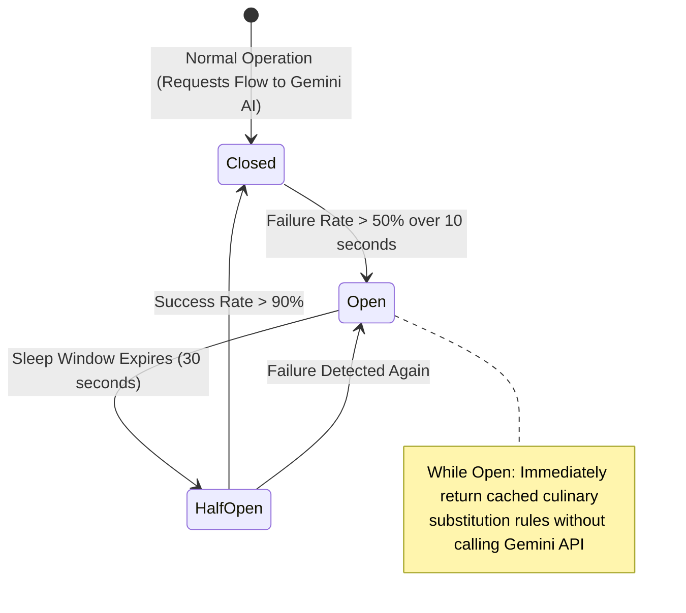

# 14.9 Reliability, Resilience & Graceful Degradation

## 1. Plain English Overview
Reliability and resilience ensure that a system continues functioning correctly even when components, networks, third-party APIs, or database nodes experience hardware failures, rate limits, or network partitions.

---

## 2. Usage in Cooking Nexus
- **Edge AI Resilient Fallback**: In [ai-stream.ts:L29-L36](file:///Users/avishjain/avishjain9-repos/26-cooking-nexus/27-kitchen-companion-pro/src/lib/ai-stream.ts#L29-L36), when the AI gateway returns 429 (Rate Limit) or 402 (Credits Exhausted), the client displays a non-blocking toast banner rather than crashing the active cooking UI.
- **Offline Timer Execution**: Kitchen countdown timers run locally via Web Audio API, functioning seamlessly even if the internet connection is severed.

---

## 3. Resilience Patterns: Circuit Breaker Flow

---

## 4. Resilience Patterns Comparison

| Pattern | Mechanism | Failure Addressed | Recovery Action | Fit for Cooking Nexus |
|---|---|---|---|---|
| **Circuit Breaker** | Trips open when downstream service fails | Third-party AI gateway outage | Fast fail without hanging threads | Mandatory for Lovable / Gemini API |
| **Exponential Backoff** | Doubles retry delay ($2^n \times \text{jitter}$) | Transient network blips | Retries with randomized jitter | Optimal for failed IoT telemetry pings |
| **Bulkhead** | Isolates thread/connection pools | Resource exhaustion in one route | Prevents cascade to other routes | Separates vision ingestion from auth |
| **Graceful Degradation** | Replaces complex feature with simple fallback | Partial system outage | Serves static recipe data | Serves offline recipe cards |
| **Rate Limiter / Shedding** | Rejects excess requests over capacity | Denial of service / traffic surges | Returns HTTP 429 immediately | Protects Express server from DDOS |

---

## 5. Availability Targets & The Meaning of "Nines"
- **Target for Ingestion Server**: 99.9% ("Three Nines") $\approx$ Max 8.76 hours of downtime per year.
- **Target for Static Frontend**: 99.99% ("Four Nines") $\approx$ Max 52.6 minutes of downtime per year (achieved via Multi-AZ CDN).

---

## 6. What Breaks First at Scale?
- **At 10x**: External AI gateway timeouts freeze UI spinners if client timeout headers are missing.
- **At 100x**: Cascading failure: a slow MongoDB query exhausts Express request sockets, causing ALB health check failures across all instances.
- **At 1,000x**: Catastrophic regional cloud provider outage (AWS or Cloudflare outage).

---

## 7. Senior Engineer Improvements
1. Wrap the AI edge gateway client with **Opossum Circuit Breaker** in Deno: automatically trip after 5 consecutive timeouts and serve static recipe substitution tables.
2. Implement an **Offline-First Service Worker (PWA)**: cache the top 100 most popular recipes in browser IndexedDB, allowing complete recipe preparation completely offline.

---

## 8. Spoken Interview Answer (30 Seconds)
"To guarantee high reliability for home cooks, we design for graceful degradation. If our generative AI gateway experiences downtime or rate limits, our circuit breaker fails fast and falls back to a curated in-memory substitution dictionary. For kitchen safety, camera sensors process optical frames locally at the hardware level, sounding an immediate physical buzzer during fire hazards even if our cloud backend is completely unreachable."
